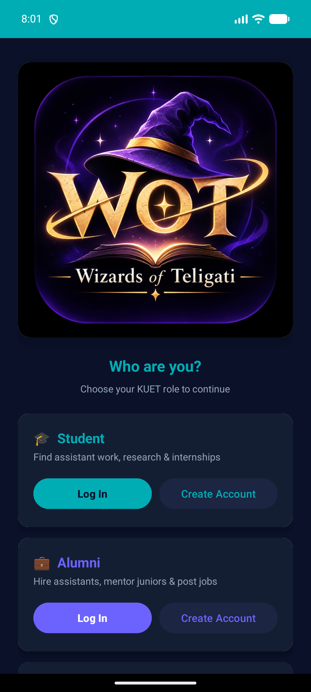
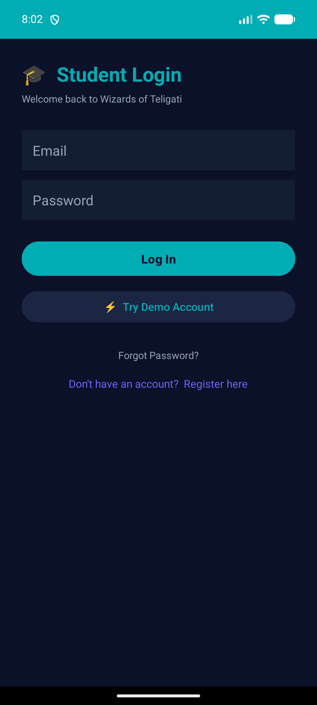
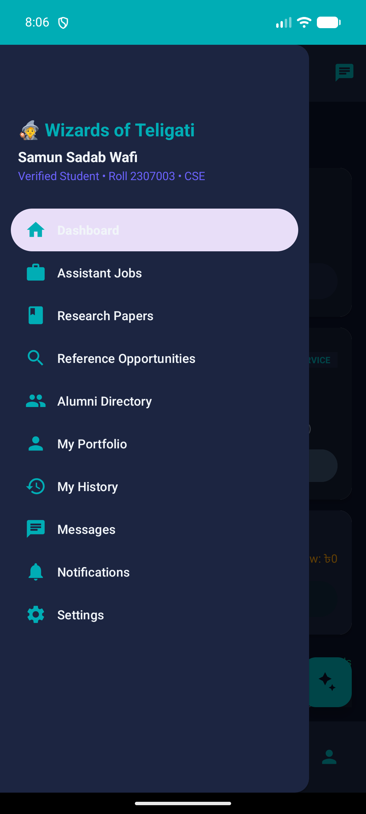
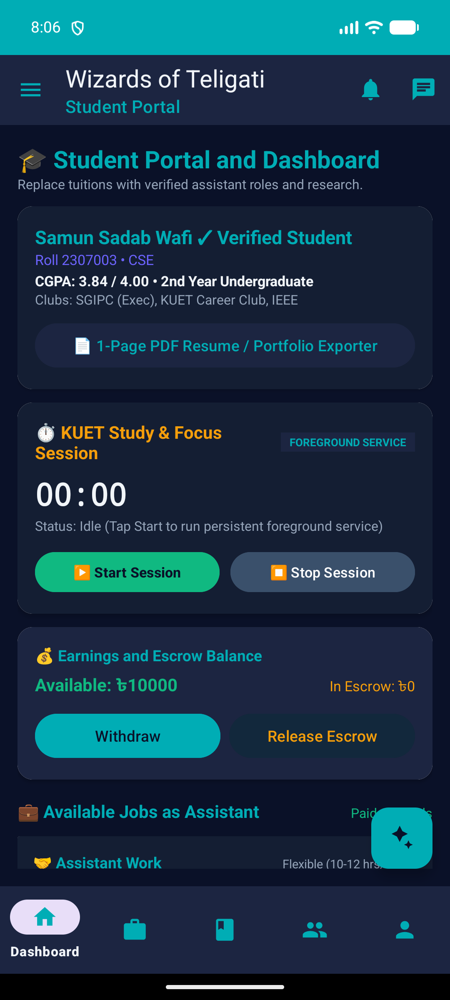
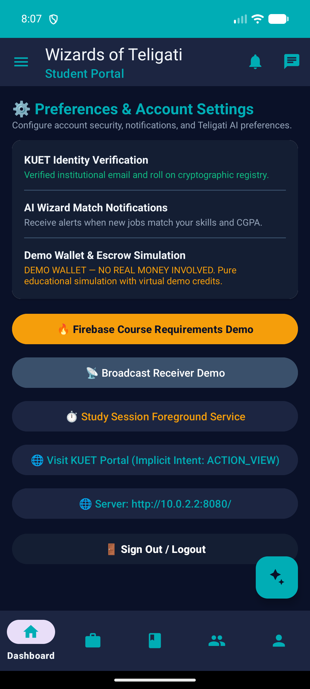
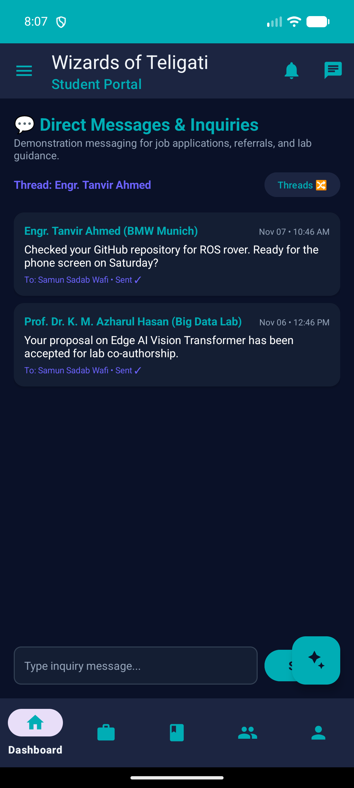
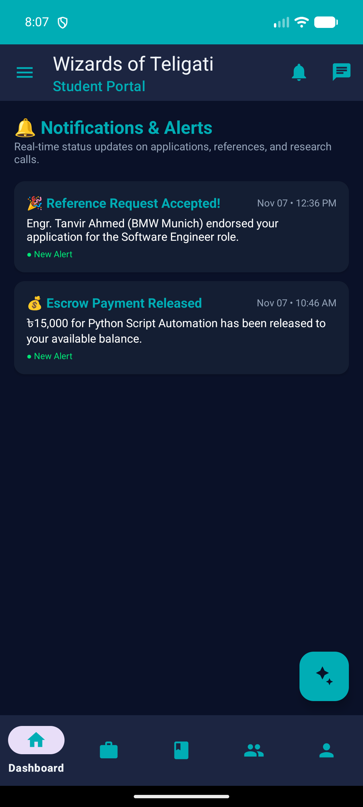
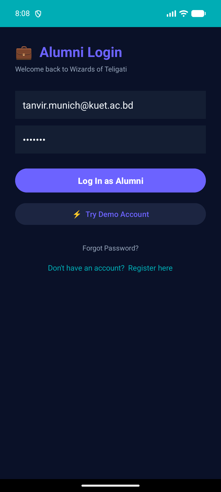
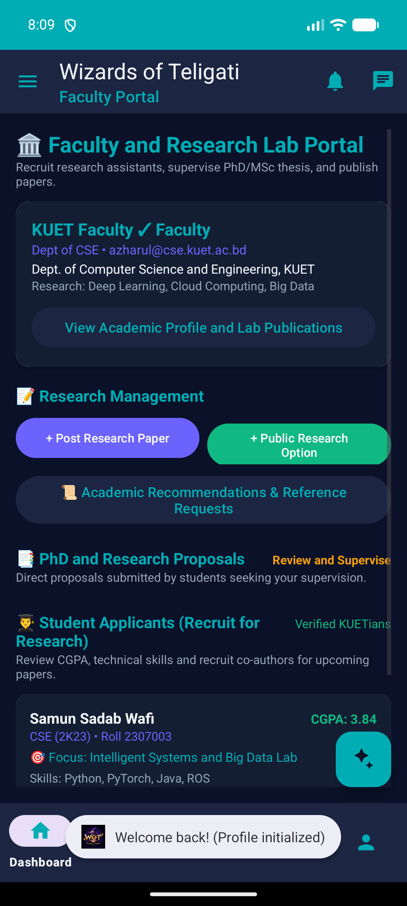

# Wizards of Teligati

> **A Role-Based Distributed Academic, Research & Career Collaboration Platform for KUET**  
> *Department of Computer Science and Engineering • Khulna University of Engineering & Technology (KUET)*

[](https://github.com/wafi240/wizards_of_teligati/actions/workflows/build-apk.yml)
[](https://developer.android.com)
[](https://firebase.google.com)
[](#)

---

## 📱 Quick Download & Install (Real Android Phone)

You can install and run **Wizards of Teligati** on any Android device running **Android 8.0 (API 26) or newer**:

1. **Direct APK Download:**  
   👉 **[Download app-debug.apk (v1.1.0)](https://github.com/wafi240/wizards_of_teligati/releases/download/v1.1.0/app-debug.apk)**  
   *(Or browse the [GitHub Releases Page](https://github.com/wafi240/wizards_of_teligati/releases))*
2. **Enable Installation:** When prompted by Android (Chrome/Files), tap **Settings** and enable **"Allow from this source"** (standard for non-Play Store academic releases).
3. **Install & Launch:** Tap **Install**, then tap **Open**.
4. **Log In:** On the Authentication Gateway, pick your role and log in using any of the pre-configured academic demo credentials below.

---

## 1. Overview

**Wizards of Teligati** is an Android mobile platform engineered specifically for the students, faculty members, and alumni of Khulna University of Engineering & Technology (KUET), located in Teligati, Khulna.

The application addresses campus communication fragmentation by providing a serverless, reactive cloud architecture using **Google Firebase Cloud Firestore** as the single source of truth, backed by **Room SQLite** for offline caching.

---

## 2. Key Features

- **Role-Based Authentication Gateway:** Specialized portals for **Students**, **Faculty Teachers**, and **Alumni** with strict role isolation and server-side validation.
- **Dual-Tier User Profiles:** Private encrypted data stored securely in `users/{uid}`; sanitized, public directory cards stored in `public_profiles/{uid}`.
- **Research Collaboration Hub:** Faculty publishing repository with research areas and PDF links; undergraduate research proposal submission, advisor matching, and review.
- **Assistant Jobs & Career Board:** Departmental research assistantships and alumni freelance gigs with complete application lifecycles (*Pending, Accepted, Rejected, Withdrawn*).
- **Simulated Demo Wallet & Escrow Ledger:** Milestone-based simulated micro-economy ensuring transparent project funding without real-world banking liability.
- **Alumni Mentorship & Reference Pipeline:** Formal recommendation request system connecting undergraduates with verified graduates for job referrals and graduate school guidance.
- **Real-Time Direct Messaging:** 1-to-1 chat threads powered by Firestore real-time snapshot listeners.
- **In-App Notification Center:** Automated notifications dispatched on job decisions, message arrivals, and reference updates.
- **Offline Mirroring:** Local SQLite persistence with Android Room ensuring instant reads and graceful offline degradation.

---

## 3. User Roles and Capabilities

| Domain / Capability | Student Role | Faculty Teacher Role | Alumni Role |
| :--- | :--- | :--- | :--- |
| **Directory Search** | Browse public profiles | Browse public profiles | Browse public profiles |
| **Assistant Jobs** | Browse & apply for roles | Post assistant positions & review applicants | Post assistant & industry roles |
| **Research Papers** | Read papers & access preprints | Publish, edit & manage own research papers | Read papers & access preprints |
| **Research Proposals** | Submit proposals to teachers | Review, accept & reject student proposals | Read-only |
| **Reference Requests** | Request recommendations from alumni | Inactive | Accept, complete & decline requests |
| **Direct Messaging** | Chat with any campus user | Chat with any campus user | Chat with any campus user |
| **Demo Wallet & Escrow** | Receive demo stipend / payee | Fund assistant positions / payer | Fund assistant positions / payer |

---

## 4. Pre-Configured Demo Accounts

For demonstration and academic evaluation, the following accounts are pre-configured in Firebase Authentication and Cloud Firestore:

| Name | Role | Email | Password | Academic / Professional Profile |
| :--- | :--- | :--- | :--- | :--- |
| **Farhan** | `STUDENT` | `farhan.student.demo@example.com` | `123456` | Student • Dept. of CSE • Roll: 2007001 • Batch 2K20 |
| **Raju** | `STUDENT` | `raju.student.demo@example.com` | `123456` | Student • Dept. of CSE • Roll: 2007002 • Batch 2K20 |
| **Adnan** | `ALUMNI` | `adnan.alumni.demo@example.com` | `123456` | Senior Software Engineer • Batch 2K15 • CSE |
| **Joy** | `ALUMNI` | `joy.alumni.demo@example.com` | `123456` | Cloud Solutions Architect • Batch 2K16 • CSE |
| **Fahad** | `TEACHER` | `fahad.teacher.demo@example.com` | `123456` | Lecturer • Dept. of CSE • Distributed Systems |
| **Wafi** | `TEACHER` | `wafi.teacher.demo@example.com` | `123456` | Assistant Professor • Dept. of CSE • AI & Vision |

> **Note:** Passwords are for academic evaluation purposes. The application does not store plaintext credentials; all logins are authenticated via Firebase Authentication.

---

## 5. Technology Stack

- **Mobile Client:** Native Android (Java 17, Android SDK 34 / Android 14)
- **Architecture:** Android Jetpack, MVVM, Repository Pattern, ViewBinding
- **Cloud Backend:** Google Cloud Firestore (NoSQL Document Store), Firebase Authentication, Firebase Cloud Storage
- **Local Persistence & Cache:** Android Room 2.6.1 (SQLite ORM)
- **Networking:** Retrofit 2, OkHttp 3, Gson
- **Security:** Android Keystore `EncryptedSharedPreferences` (AES-256 GCM)
- **Rule Verification:** Node.js 20+, `@firebase/rules-unit-testing`, Cloud Firestore Emulator v1.22.0
- **Unit Testing:** JUnit 4, Robolectric, Mockito
- **Build System:** Gradle 8.5 with Android Gradle Plugin (AGP) 8.2.0

---

## 6. System Architecture

```
+-------------------------------------------------------------------------------+
|                       Android Presentation Layer                              |
|   Activities (AuthGateway, MainActivity) & Fragments (Jobs, Research, etc.)   |
+---------------------------------------+---------------------------------------+
                                        |
+---------------------------------------v---------------------------------------+
|                       Domain & Repository Layer                               |
|   (ProfileRepository, OpportunityRepository, ResearchRepository, Messaging)   |
+-------------------+---------------------------------------+-------------------+
                    |                                       |
+-------------------v-------------------+   +---------------v-------------------+
|     Local Cache Layer (Room DB)       |   |   Cloud Persistence (Firestore)   |
|   - AppDatabase (SQLite)              |   |   - users / public_profiles       |
|   - Offline Mirror & Instant Reads    |   |   - jobs / job_applications       |
|   - Query Results Caching             |   |   - research_papers / proposals   |
+---------------------------------------+   |   - conversations / messages      |
                                            |   - reference_requests / escrow   |
                                            +-----------------------------------+
```

---

## 7. Database Structure & Firestore Schema

| Collection Path | Privacy Scope | Schema & Description |
| :--- | :--- | :--- |
| `users/{uid}` | Private (Owner read/write) | `uid`, `email`, `role`, `name`, `department`, `roll`, `createdAt` |
| `public_profiles/{uid}` | Public (Authenticated read) | `uid`, `name`, `role`, `department`, `batch`, `skills`, `bio` |
| `authorized_faculty/{email}` | Authorization Registry | `email`, `name`, `department`, `designation`, `authorizedAt` |
| `jobs/{jobId}` | Public (Auth read, Poster write) | `jobId`, `posterUid`, `posterRole`, `title`, `stipend`, `jobType`, `status` |
| `job_applications/{appId}` | Restricted (Applicant/Poster) | `applicationId`, `jobId`, `applicantUid`, `posterUid`, `status` |
| `research_papers/{paperId}` | Public (Auth read, Teacher write)| `paperId`, `ownerUid`, `title`, `abstract`, `researchArea`, `paperUrl` |
| `research_proposals/{propId}` | Restricted (Student/Teacher) | `proposalId`, `studentUid`, `teacherUid`, `title`, `abstract`, `status` |
| `reference_requests/{reqId}` | Restricted (Student/Alumni) | `requestId`, `studentUid`, `alumniUid`, `details`, `status` |
| `conversations/{convId}` | Restricted (Participants only) | `conversationId`, `participants`, `lastMessage`, `lastMessageTime` |
| `conversations/{cId}/messages/{mId}` | Restricted (Participants) | `messageId`, `senderUid`, `text`, `timestamp`, `read` |
| `users/{uid}/notifications/{nId}` | Private (Owner only) | `notificationId`, `title`, `message`, `type`, `isRead`, `timestamp` |
| `users/{uid}/demo_wallet/balance` | Private (Owner only) | `balance`, `currency`, `lastUpdated` |
| `demo_escrow/{escrowId}` | Restricted (Payer/Payee) | `escrowId`, `payerUid`, `payeeUid`, `amount`, `status` |

---

## 8. Simulated Demo Wallet & Escrow Ledger

The application includes an educational **Simulated Wallet & Escrow System** designed to demonstrate micro-economic incentives for campus collaboration:
- **Simulated Balances:** Each account receives demo credits (e.g., 10,000 DEMO_CREDITS) for testing assistant job funding and payouts.
- **Escrow Lock:** When an alumni or faculty member hires a student assistant, funds are locked in `demo_escrow/{escrowId}` in `FUNDED` status.
- **Milestone Release:** Upon student completion, the payer releases escrow funds to the student payee (`RELEASED` status).
- **Educational Scope:** No real-world banking APIs, credit cards, or mobile financial services (bKash/Nagad) are involved. The feature operates entirely through Firestore Security Rules.

---

## 9. How to Build and Run

### 1. Prerequisites
- **JDK:** Java 17 (OpenJDK 17 recommended)
- **Android Studio:** Hedgehog / Iguana / Ladybug (SDK Platform 34)
- **Node.js:** v18 or v20 LTS (for Firestore emulator tests)

### 2. Build via Command Line
```powershell
# Navigate to the Android subfolder
cd android

# Run all 155 unit tests
.\gradlew.bat testDebugUnitTest

# Assemble the debug APK
.\gradlew.bat assembleDebug

# Output APK path:
# android/app/build/outputs/apk/debug/app-debug.apk
```

### 3. Run Firestore Security Rules Tests (107 tests)
```powershell
# Terminal 1: Launch Firestore Emulator
java -jar "$env:USERPROFILE\.cache\firebase\emulators\cloud-firestore-emulator-v1.22.0.jar" --host 127.0.0.1 --port 8081 --rules firestore.rules

# Terminal 2: Run test suite
cd firestore_emulator_test
node test_all_rules.js
# Expected: 107 passed, 0 failed
```

---

## 10. Screenshots & Visual Interface

All screenshots captured live from an active Android 14 (API 34) device running `app-debug.apk`:

| Screenshot | Screen Name | Description |
| :--- | :--- | :--- |
|  | **Auth Gateway** | Role selection for Student, Alumni, and Faculty portals. |
|  | **Student Login** | Institutional login with secure password authentication. |
|  | **Student Dashboard** | Central navigation hub with quick actions and stats. |
|  | **Navigation Drawer** | Slide-out role menu for Assistant Jobs, Papers, and Settings. |
|  | **Assistant Jobs** | List of campus assistant gigs with stipend and application options. |
|  | **Research Papers** | Repository of faculty publications with PDF links. |
|  | **Alumni Directory** | Searchable verified alumni contacts and company tags. |
|  | **Settings & Wallet** | Simulated demo coin balance, top-up, and escrow controls. |
|  | **Messages** | Real-time direct chat threads between campus users. |
|  | **Notifications** | Chronological feed of application and reference status updates. |
|  | **Alumni Dashboard** | Portal for posting jobs and reviewing student applicants. |
|  | **Faculty Dashboard** | Portal for publishing papers and evaluating research proposals. |

---

## 11. Project Structure

```
Wizards_of_teligati/
├── android/                             # Android Studio native project
│   ├── app/
│   │   ├── src/main/java/com/teligati/app/
│   │   │   ├── auth/                    # Gateway, Login & Register Activities
│   │   │   ├── data/                    # Room Database, DAOs & Entities
│   │   │   ├── fragment/                # Role Dashboards, Jobs, Research, Messages
│   │   │   ├── model/                   # Data Models & POJOs
│   │   │   ├── repository/              # Firestore & Room Repositories
│   │   │   └── MainActivity.java        # Main Navigation Activity
│   │   ├── src/main/res/                # Layouts, Menus, Values, Drawables
│   │   └── src/test/java/               # 155 Android Unit Tests
│   └── build.gradle.kts                 # Android Gradle build configuration
├── backend/                             # Legacy Spring Boot backend (Preserved backup)
├── firestore_emulator_test/             # 107 Automated Firestore Security Rule Tests
│   ├── test_all_rules.js                # Security scenario verification harness
│   └── seed_demo_data.js                # Initial demo dataset seeder
├── docs/                                # Project reports & architecture specifications
├── assets/screenshots/                  # Live application screenshots
├── firestore.rules                      # Production Firestore Security Rules
├── storage.rules                        # Firebase Storage Security Rules
├── firebase.json                        # Firebase Project Configuration
└── README.md                            # Complete Project Documentation
```

---

## 12. Security & Compliance

- **No Secrets in Repository:** Keystores, service account private keys, passwords, and environment credentials are excluded via `.gitignore`.
- **Zero-Trust Firestore Rules:** 107 declarative security tests guarantee that ordinary users cannot escalate privileges or read another user's private data.
- **Faculty Authorization Guard:** Teachers must be pre-authorized in `authorized_faculty` before creating a faculty profile.
- **Client Encryption:** Session tokens and cached identity credentials use Android's `EncryptedSharedPreferences` backed by the Android Keystore.
