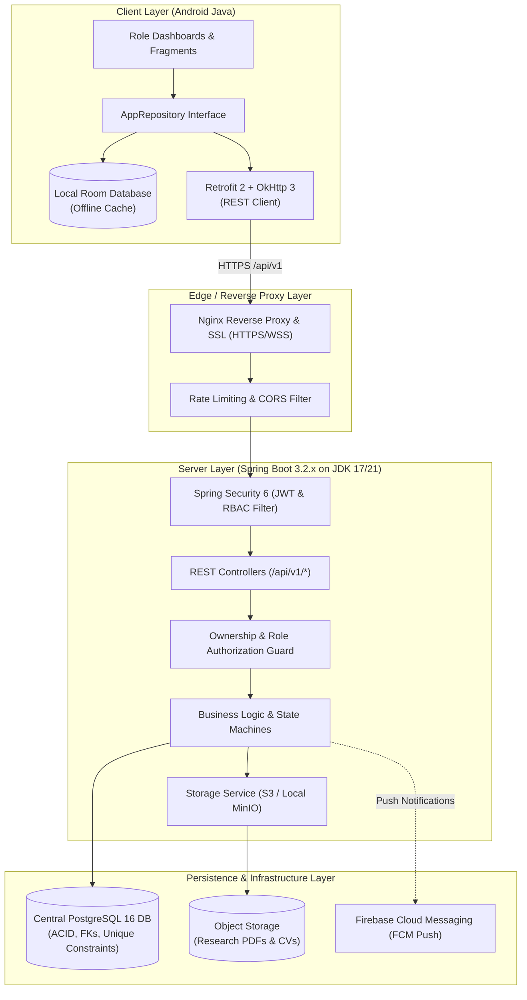
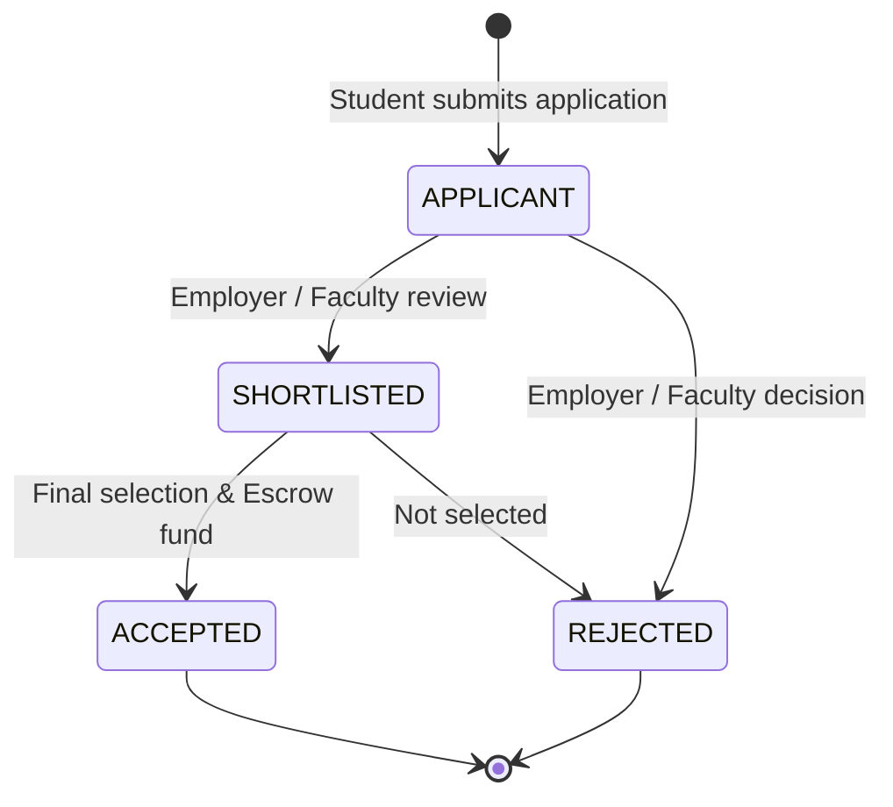
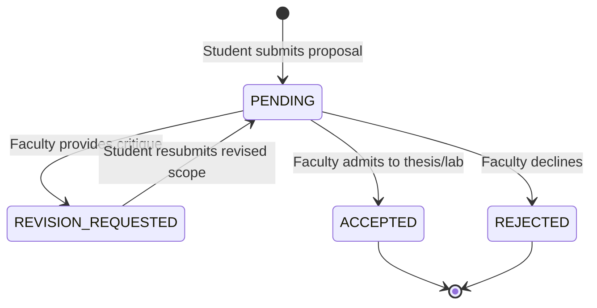
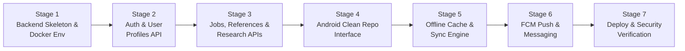

# Wizards of Teligati — Phase 5A: Backend Architecture & API Contract Plan

**Document Version:** 1.0.0  
**Date:** November 2026  
**Status:** Approved for Implementation Planning  
**Target Client:** Wizards of Teligati Android Application (Java, MinSDK 24, TargetSDK 34)  

---

## 1. Executive Summary & Architecture Recommendation

### 1.1 Context & Current State
The *Wizards of Teligati* Android application currently operates with a fully decoupled Room persistence layer, role-specific navigation, and local reactive state management for three core user roles:
- **Students:** Browse assistant and professional jobs, submit reference requests to alumni, review research publications, submit thesis/PhD proposals, and manage personal portfolio/history.
- **Alumni:** Post professional job opportunities and assistant tasks, review candidate applicants, endorse reference requests, and maintain alumni directory profiles.
- **Teachers (Faculty):** Publish research papers and lab openings, evaluate thesis and research proposals with feedback loops, admit student researchers, and manage academic profiles.

An initial skeleton project exists in the [`backend/`](file:///c:/Users/HP/OneDrive/Desktop/Wizards_of_teligati/backend) folder containing a baseline Spring Boot 3.2.4 setup with Spring Data JPA and PostgreSQL dependencies.

---

### 1.2 Recommended Architecture & Technology Stack



### 1.3 Stack Evaluation & Trade-off Analysis

| Component | Recommendation | Alternatives Considered | Rationale for Wizards of Teligati |
|---|---|---|---|
| **Language & Framework** | **Java 17/21 + Spring Boot 3.2.x** | Node.js (Express/NestJS), Python (FastAPI), Go (Fiber) | 1. **Codebase Continuity:** The repository already contains a Gradle-configured Spring Boot 3 skeleton in `backend/`.<br>2. **Language Synergy:** The Android app is written in Java; sharing model definitions, validation conventions, and typing prevents impedance mismatch.<br>3. **Enterprise Security:** Spring Security 6 provides proven JWT verification, `@PreAuthorize` method security, and robust role-based access control out-of-the-box.<br>4. **Transaction Integrity:** Spring Data JPA / Hibernate delivers ACID compliance required for application status transitions and escrow balances. |
| **Relational Database** | **PostgreSQL 16** | MySQL, MongoDB, Firebase Firestore | 1. Strong relational integrity with foreign key cascade actions, unique constraints, and schema migrations via Flyway.<br>2. Built-in support for `TEXT[]` arrays or JSONB for skills and project lists without breaking normal form.<br>3. Native full-text search (`tsvector`) for indexing alumni directories, job descriptions, and research papers. |
| **Object / Document Storage** | **S3-Compatible Storage (MinIO on-prem / Cloudflare R2)** | Local Disk uploads, AWS S3 | Allows hosting research paper PDFs and student portfolio documents on KUET campus servers (via MinIO) or scalable cloud storage (Cloudflare R2 with zero egress fees). Accessible via pre-signed download URLs. |
| **Authentication & RBAC** | **Stateless JWT (Access + Refresh Tokens)** | Session Cookies, OAuth2 Only | Essential for mobile REST API consumption. Short-lived access token (15 mins) + rotating refresh token (30 days) stored securely in Android `EncryptedSharedPreferences`. |
| **Real-time & Push** | **REST Polling + Firebase Cloud Messaging (FCM)** | WebSockets only, Long Polling | REST endpoints handle transactional fetching while FCM wakes the Android client for new messages, applicant updates, and proposal decisions even when the app is in the background. |
| **Deployment** | **Docker & Docker Compose** | Bare-metal JAR execution, Kubernetes | Enables 1-command startup (`docker compose up -d`) packaging PostgreSQL, Spring Boot backend, and Nginx reverse proxy. Ideal for KUET server deployment or VPS. |

---

## 2. Mapping Existing Room Data to Server Schemas

The Android client currently persists 13 Room entities across authentication, profiles, career opportunities, research, messaging, and transactions. Below is the mapping from Room client structures to PostgreSQL database tables.

### 2.1 Entity Mapping Table

| Room Entity (Android) | Proposed Server Table | Primary Key | Key Relationships & Foreign Keys | Data Types & Required Fields | Ownership & Authorization Rule | Room Caching Role |
|---|---|---|---|---|---|---|
| `UserEntity` | `users` | `id` (BIGSERIAL) | 1:1 with `student_profiles`, `alumni_profiles`, `teacher_profiles` | `kuet_id` VARCHAR(50) UNIQUE NOT NULL<br>`email` VARCHAR(100) UNIQUE NOT NULL<br>`password_hash` VARCHAR(255) NOT NULL<br>`role` VARCHAR(20) NOT NULL<br>`name` VARCHAR(100) NOT NULL<br>`department` VARCHAR(50)<br>`is_verified` BOOLEAN DEFAULT FALSE<br>`available_balance` NUMERIC(12,2) DEFAULT 0.00<br>`escrow_balance` NUMERIC(12,2) DEFAULT 0.00 | Self can read own record. Public directory exposes name, dept, and role only. Balance is private to owner. | Cached locally in Room for offline profile display. |
| `StudentProfileEntity` | `student_profiles` | `id` (BIGSERIAL) | `user_id` FK -> `users(id)` ON DELETE CASCADE (UNIQUE) | `roll` VARCHAR(20) UNIQUE NOT NULL<br>`cgpa` NUMERIC(3,2)<br>`skills` TEXT<br>`projects` TEXT<br>`github_url` VARCHAR(255)<br>`linkedin_url` VARCHAR(255)<br>`specialization` VARCHAR(100)<br>`clubs` VARCHAR(255)<br>`bio` TEXT | Modifiable **only** by the authenticated student (`roll == auth.roll`). CGPA is private; visible only to faculty and employers of applied jobs. | Cached locally in Room; synced on profile update. |
| `AlumniProfileEntity` | `alumni_profiles` | `id` (BIGSERIAL) | `user_id` FK -> `users(id)` ON DELETE CASCADE (UNIQUE) | `current_company` VARCHAR(100)<br>`current_position` VARCHAR(100)<br>`country` VARCHAR(50)<br>`city` VARCHAR(50)<br>`is_verified` BOOLEAN DEFAULT FALSE<br>`is_available_for_mentorship` BOOLEAN<br>`is_actively_hiring` BOOLEAN<br>`skills` TEXT<br>`bio` TEXT | Modifiable **only** by the authenticated alumni owner. Publicly readable by all verified KUET students and faculty. | Cached locally; supports offline directory browsing. |
| `TeacherProfileEntity` | `teacher_profiles` | `id` (BIGSERIAL) | `user_id` FK -> `users(id)` ON DELETE CASCADE (UNIQUE) | `designation` VARCHAR(100)<br>`research_focus` TEXT<br>`lab_name` VARCHAR(150)<br>`publications_count` INT DEFAULT 0<br>`contact_email` VARCHAR(100)<br>`bio` TEXT | Modifiable **only** by the authenticated faculty member. Publicly readable across the platform. | Cached locally in Room. |
| `JobPostingEntity` | `job_postings` | `id` (BIGSERIAL) | `posted_by_user_id` FK -> `users(id)` ON DELETE RESTRICT | `title` VARCHAR(150) NOT NULL<br>`category` VARCHAR(30) NOT NULL (`ASSISTANT_WORK`, `FULLTIME_JOBS`, etc.)<br>`organization` VARCHAR(100)<br>`location` VARCHAR(100)<br>`compensation` VARCHAR(100)<br>`duration` VARCHAR(100)<br>`description` TEXT NOT NULL<br>`skills_required` TEXT<br>`min_cgpa` NUMERIC(3,2)<br>`status` VARCHAR(20) DEFAULT 'ACTIVE' | Created by ALUMNI or TEACHER. Modifiable/deletable **only** by posting owner. Read-only for STUDENTS. | Cached locally; filtered by role and category. |
| `JobApplicationEntity` | `job_applications` | `id` (BIGSERIAL) | `job_id` FK -> `job_postings(id)` ON DELETE CASCADE<br>`applicant_user_id` FK -> `users(id)` | `applicant_roll` VARCHAR(20) NOT NULL<br>`applicant_name` VARCHAR(100)<br>`applicant_cgpa` NUMERIC(3,2)<br>`applicant_skills` TEXT<br>`statement` TEXT<br>`status` VARCHAR(20) NOT NULL (`APPLICANT`, `SHORTLISTED`, `ACCEPTED`, `REJECTED`)<br>`applied_at` BIGINT NOT NULL<br>**UNIQUE constraint: `(job_id, applicant_user_id)`** | Student can submit and view their own applications. Employer can view applications for their own postings and update status. | Cached locally; prevents duplicate submissions locally before network round-trip. |
| `ReferenceRequestEntity` | `reference_requests` | `id` (BIGSERIAL) | `student_user_id` FK -> `users(id)`<br>`alumni_user_id` FK -> `users(id)` | `target_company` VARCHAR(100) NOT NULL<br>`message` TEXT NOT NULL<br>`status` VARCHAR(20) NOT NULL (`PENDING`, `ENDORSED`, `DECLINED`)<br>`endorsement_note` TEXT<br>`requested_at` BIGINT NOT NULL | Student can create and inspect their own requests. Target alumni can inspect and update status (`ENDORSED`/`DECLINED`). | Cached locally in Room for offline access. |
| `ResearchPaperEntity` | `research_papers` | `id` (BIGSERIAL) | `owner_user_id` FK -> `users(id)` | `title` VARCHAR(200) NOT NULL<br>`type` VARCHAR(50) NOT NULL (`Call for Co-Authors`, `Research Paper`)<br>`description` TEXT NOT NULL<br>`technologies` TEXT<br>`owner_name` VARCHAR(100)<br>`owner_dept` VARCHAR(50)<br>`contributors_count` INT DEFAULT 1<br>`is_open_for_contribution` BOOLEAN DEFAULT TRUE<br>`github_url` VARCHAR(255)<br>`paper_doi` VARCHAR(100)<br>`paper_pdf_url` VARCHAR(255) | Published/edited/deleted **only** by the owner faculty member. Publicly readable by all students. | Cached locally for lab and project feeds. |
| `ResearchProposalEntity` | `research_proposals` | `id` (BIGSERIAL) | `student_user_id` FK -> `users(id)`<br>`teacher_user_id` FK -> `users(id)` | `topic` VARCHAR(200) NOT NULL<br>`proposal_abstract` TEXT NOT NULL<br>`degree_type` VARCHAR(50) NOT NULL (`PhD Proposal`, `Undergrad Thesis`)<br>`status` VARCHAR(30) NOT NULL (`PENDING`, `ACCEPTED`, `REVISION_REQUESTED`, `REJECTED`)<br>`feedback` TEXT<br>`submitted_at` BIGINT NOT NULL | Student can submit and view their proposals. Target teacher can view and update status/feedback. | Cached locally; triggers notification on feedback update. |
| `ResearchApplicationEntity` | `research_applications` | `id` (BIGSERIAL) | `opportunity_id` FK -> `research_papers(id)` ON DELETE CASCADE<br>`student_user_id` FK -> `users(id)` | `student_roll` VARCHAR(20) NOT NULL<br>`cgpa` NUMERIC(3,2)<br>`skills` TEXT<br>`lab_interest` TEXT<br>`status` VARCHAR(20) NOT NULL<br>`applied_at` BIGINT NOT NULL<br>**UNIQUE constraint: `(opportunity_id, student_user_id)`** | Student can register interest once. Lab owner faculty can review and accept/reject applicants. | Cached locally in Room. |
| `MessageEntity` | `messages` | `id` (BIGSERIAL) | `sender_id` FK -> `users(id)`<br>`receiver_id` FK -> `users(id)` | `content` TEXT NOT NULL<br>`sent_at` BIGINT NOT NULL<br>`is_read` BOOLEAN DEFAULT FALSE | Visible **only** to the sender and receiver. Neither party can read unassociated conversations. | Cached locally for instant offline UI rendering. |
| `NotificationEntity` | `notifications` | `id` (BIGSERIAL) | `user_id` FK -> `users(id)` ON DELETE CASCADE | `title` VARCHAR(150) NOT NULL<br>`message` TEXT NOT NULL<br>`action_url` VARCHAR(255)<br>`is_read` BOOLEAN DEFAULT FALSE<br>`created_at` BIGINT NOT NULL | Private to the targeted user. | Cached locally; badge count synced with server. |
| `TransactionEntity` | `transactions` | `id` (BIGSERIAL) | `user_id` FK -> `users(id)` | `transaction_id` VARCHAR(50) UNIQUE NOT NULL<br>`title` VARCHAR(150)<br>`category` VARCHAR(50)<br>`amount` NUMERIC(12,2)<br>`status` VARCHAR(30) (`COMPLETED`, `IN_ESCROW`)<br>`created_at` BIGINT NOT NULL | Visible only to the account owner and financial administrators. | Cached locally for student/alumni balance history. |

---

### 2.2 Model Reconciliation & Inconsistencies Fixed
1. **User Identifier Consistency:**
   - In Room, `UserEntity.id` was stored as a string (`"2307003"`, `"tanvir.munich@kuet.ac.bd"`). In PostgreSQL, a canonical `BIGSERIAL` (or UUID) `id` will serve as the relational primary key across all tables, with `kuet_id` and `email` indexed as UNIQUE candidate keys.
2. **Password Security:**
   - Room currently stores demo passwords in plain text or client constants. The backend will enforce BCrypt/Argon2 password hashing with minimum 12-round salt.
3. **Foreign Key Guarantees:**
   - Room relied on manual cascade deletions in repository code. The backend PostgreSQL schema will enforce `ON DELETE CASCADE` for applications and proposals, guaranteeing zero orphaned records.
4. **Skills & Tech Stacks:**
   - Stored as comma-separated strings in Room for simplicity. The PostgreSQL schema will support both standard comma-delimited strings and native GIN-indexed arrays for high-performance candidate search.

---

## 3. Comprehensive REST API Contract

All endpoints follow standard REST principles with uniform JSON envelopes and status codes:
- **Base URL:** `https://api.teligati.kuet.ac.bd/api/v1`
- **Standard Success Response Shape:**
  ```json
  {
    "success": true,
    "data": { ... },
    "message": "Operation completed successfully",
    "timestamp": 1793798400000
  }
  ```
- **Standard Error Response Shape:**
  ```json
  {
    "success": false,
    "error": {
      "code": "RESOURCE_NOT_FOUND",
      "message": "The requested job posting does not exist.",
      "details": []
    },
    "timestamp": 1793798400000
  }
  ```

---

### 3.1 Authentication & Session Management

#### `POST /api/v1/auth/login`
- **Role Required:** Public
- **Request Body:**
  ```json
  {
    "identifier": "2307003",
    "password": "userPassword123"
  }
  ```
- **Success Response (`200 OK`):**
  ```json
  {
    "success": true,
    "data": {
      "accessToken": "eyJhbGciOiJIUzI1NiIsInR5...",
      "refreshToken": "d8e3f1c2-7b4a-4e9f-8a12...",
      "expiresIn": 900,
      "user": {
        "id": 1,
        "kuetId": "2307003",
        "email": "wafi2307003@stud.kuet.ac.bd",
        "role": "STUDENT",
        "name": "Samun Sadab Wafi",
        "department": "CSE",
        "isVerified": true
      }
    },
    "message": "Authentication successful"
  }
  ```
- **Errors:** `400 Bad Request` (missing fields), `401 Unauthorized` (invalid credentials), `403 Forbidden` (account unverified/suspended).

#### `POST /api/v1/auth/register/{role}`
- **Routes:** `/api/v1/auth/register/student`, `/api/v1/auth/register/alumni`, `/api/v1/auth/register/faculty`
- **Role Required:** Public
- **Request Body (Student Example):**
  ```json
  {
    "roll": "2307003",
    "name": "Samun Sadab Wafi",
    "email": "wafi2307003@stud.kuet.ac.bd",
    "department": "CSE",
    "batch": "2K23",
    "password": "StrongPassword!2026"
  }
  ```
- **Success Response (`201 Created`):** Returns created user details with pending email verification flag.
- **Errors:** `409 Conflict` (roll or institutional email already registered).

#### `POST /api/v1/auth/refresh`
- **Role Required:** Public (valid refresh token required)
- **Request Body:** `{ "refreshToken": "d8e3f1c2-7b4a-4e9f-8a12..." }`
- **Success Response (`200 OK`):** Returns new `accessToken` and rotated `refreshToken`.

#### `POST /api/v1/auth/logout`
- **Role Required:** Authenticated (`Bearer <token>`)
- **Request Body:** `{ "refreshToken": "d8e3f1c2-7b4a-4e9f-8a12..." }`
- **Success Response (`200 OK`):** Invalidates the refresh token server-side.

---

### 3.2 Profiles & Alumni Directory

#### `GET /api/v1/profiles/student/{roll}`
- **Role Required:** Authenticated
- **Success Response (`200 OK`):**
  ```json
  {
    "success": true,
    "data": {
      "roll": "2307003",
      "name": "Samun Sadab Wafi",
      "department": "CSE",
      "batch": "2023",
      "cgpa": 3.84,
      "skills": "AI, Robotics, ROS, C++, Python",
      "projects": "Autonomous Campus Rover, Edge AI Vision Node",
      "githubUrl": "https://github.com/samunwafi",
      "linkedinUrl": "https://linkedin.com/in/wafi",
      "specialization": "Intelligent Systems",
      "clubs": "KUET Robotics Club",
      "bio": "Undergraduate researcher focused on Edge AI and ROS navigation stacks."
    }
  }
  ```

#### `PUT /api/v1/profiles/student/{roll}`
- **Role Required:** `STUDENT` (Ownership check: `auth.roll == roll`)
- **Request Body:** Updated profile fields (skills, projects, bio, links).
- **Success Response (`200 OK`):** Returns updated profile.
- **Errors:** `403 Forbidden` (student attempting to modify another student's profile).

#### `GET /api/v1/directory/alumni`
- **Role Required:** Authenticated
- **Query Parameters:** `country`, `company`, `department`, `batch`, `skills`, `search`, `page`, `size`
- **Success Response (`200 OK`):**
  ```json
  {
    "success": true,
    "data": {
      "items": [
        {
          "id": 1,
          "name": "Engr. Tanvir Ahmed",
          "department": "CSE",
          "batch": "2K12",
          "currentCompany": "BMW Group",
          "currentPosition": "Staff Systems Engineer",
          "country": "Germany",
          "city": "Munich",
          "isVerified": true,
          "isAvailableForMentorship": true,
          "isActivelyHiring": true,
          "skills": "ROS, C++, Cloud, Architecture"
        }
      ],
      "page": 0,
      "totalPages": 1,
      "totalItems": 1
    }
  }
  ```

---

### 3.3 Career Opportunities & Job Applications

#### `GET /api/v1/jobs`
- **Role Required:** Authenticated
- **Query Parameters:** `category` (`ASSISTANT_WORK`, `FULLTIME_JOBS`, etc.), `search`, `page`, `size`
- **Success Response (`200 OK`):** Paginated list of active job postings matching criteria.

#### `POST /api/v1/jobs`
- **Role Required:** `ALUMNI` or `TEACHER`
- **Request Body:**
  ```json
  {
    "title": "Embedded Systems Assistant",
    "category": "ASSISTANT_WORK",
    "organization": "KUET Robotics & Embedded Lab",
    "location": "Khulna / Hybrid",
    "compensation": "৳15,000 / month",
    "duration": "6 Months",
    "description": "Develop firmware for STM32 and ROS micro-nodes.",
    "skillsRequired": "C++, STM32, FreeRTOS, ROS",
    "minCgpa": 3.20
  }
  ```
- **Success Response (`201 Created`):** Returns created job posting with server-generated ID and poster details.

#### `PUT /api/v1/jobs/{id}` & `DELETE /api/v1/jobs/{id}`
- **Role Required:** `ALUMNI` or `TEACHER` (Ownership check: `auth.userId == job.postedByUserId`)
- **Action on Delete:** Triggers database transaction executing cascade deletion of all associated candidate applications before removing posting record.
- **Errors:** `403 Forbidden` (user is not the poster), `404 Not Found`.

#### `POST /api/v1/jobs/{id}/apply`
- **Role Required:** `STUDENT`
- **Request Body:**
  ```json
  {
    "statement": "I have completed 3 projects using ROS SLAM and embedded microcontrollers."
  }
  ```
- **Success Response (`201 Created`):**
  ```json
  {
    "success": true,
    "data": {
      "applicationId": 101,
      "jobId": 12,
      "status": "APPLICANT",
      "appliedAt": 1793798400000
    },
    "message": "Application submitted successfully"
  }
  ```
- **Errors:** `409 Conflict` ("You have already applied for this position."), `400 Bad Request` ("Minimum CGPA requirement not met.").

#### `GET /api/v1/jobs/{id}/applications`
- **Role Required:** `ALUMNI` or `TEACHER` (Ownership check: `auth.userId == job.postedByUserId`)
- **Success Response (`200 OK`):** Returns candidate list strictly for this owned job. Non-owners receive `403 Forbidden`.

#### `PATCH /api/v1/applications/{id}/status`
- **Role Required:** Job Owner
- **Request Body:** `{ "status": "SHORTLISTED" }` (Allowed: `SHORTLISTED`, `ACCEPTED`, `REJECTED`)
- **Success Response (`200 OK`):** Updates status and triggers automatic in-app notification to the student.

---

### 3.4 Alumni Reference Requests

#### `POST /api/v1/references`
- **Role Required:** `STUDENT`
- **Request Body:**
  ```json
  {
    "alumniUserId": 1,
    "targetCompany": "BMW Group",
    "message": "Seeking internal referral and CV review for the Munich Embedded Systems opening."
  }
  ```
- **Success Response (`201 Created`):** Returns created reference request with `PENDING` status.

#### `GET /api/v1/references/alumni/received`
- **Role Required:** `ALUMNI`
- **Success Response (`200 OK`):** Returns only reference requests targeted to the authenticated alumni (`alumniUserId == auth.userId`).

#### `PATCH /api/v1/references/{id}/status`
- **Role Required:** Target Alumni
- **Request Body:**
  ```json
  {
    "status": "ENDORSED",
    "endorsementNote": "Verified KUET academic credentials. Profile endorsed for Munich engineering team."
  }
  ```
- **Success Response (`200 OK`):** Updates status and dispatches notification to the requesting student.

---

### 3.5 Research Papers, Proposals & Lab Opportunities

#### `POST /api/v1/research/papers`
- **Role Required:** `TEACHER`
- **Request Body:**
  ```json
  {
    "title": "Quantized Vision Transformers for Autonomous Rover Navigation",
    "type": "Call for Co-Authors",
    "description": "Seeking 2 undergraduate researchers to benchmark TensorRT models on Jetson Orin.",
    "technologies": "PyTorch, TensorRT, ROS 2, Python",
    "paperDoi": "doi.org/10.1145/kuet.edge.2026"
  }
  ```
- **Success Response (`201 Created`):** Returns created paper entity.

#### `POST /api/v1/research/proposals`
- **Role Required:** `STUDENT`
- **Request Body:**
  ```json
  {
    "teacherUserId": 3,
    "topic": "Distributed Consensus in Underwater Sensor Networks",
    "proposalAbstract": "Investigating low-latency consensus protocols in high-noise acoustic channels.",
    "degreeType": "Undergraduate Thesis"
  }
  ```
- **Success Response (`201 Created`):** Creates proposal with `PENDING` status.

#### `GET /api/v1/research/proposals/teacher/received`
- **Role Required:** `TEACHER`
- **Success Response (`200 OK`):** Returns only proposals submitted to this faculty member (`teacherUserId == auth.userId`).

#### `PATCH /api/v1/research/proposals/{id}/review`
- **Role Required:** Target Teacher
- **Request Body:**
  ```json
  {
    "status": "REVISION_REQUESTED",
    "feedback": "Please elaborate on physical acoustic attenuation models and benchmark hardware."
  }
  ```
- **Success Response (`200 OK`):** Updates status and persists faculty feedback.

---

### 3.6 Messaging & Conversations

#### `GET /api/v1/messages/conversations`
- **Role Required:** Authenticated
- **Success Response (`200 OK`):** Returns active conversation threads with latest message snippet and unread counts.

#### `GET /api/v1/messages/conversations/{otherUserId}`
- **Role Required:** Authenticated
- **Query Parameters:** `page`, `size`
- **Success Response (`200 OK`):** Returns chronological message history between authenticated user and `otherUserId`.

#### `POST /api/v1/messages`
- **Role Required:** Authenticated
- **Request Body:**
  ```json
  {
    "receiverId": 1,
    "content": "Good evening Sir, I have updated the requested benchmarks in my thesis abstract."
  }
  ```
- **Success Response (`201 Created`):** Dispatches message and triggers real-time FCM push notification to the receiver.

---

### 3.7 Notifications & In-App Badges

#### `GET /api/v1/notifications`
- **Role Required:** Authenticated
- **Query Parameters:** `unreadOnly` (boolean)
- **Success Response (`200 OK`):** Returns notifications targeted to the authenticated user.

#### `PATCH /api/v1/notifications/{id}/read` & `POST /api/v1/notifications/read-all`
- **Role Required:** Authenticated
- **Success Response (`200 OK`):** Marks notification(s) as read.

---

### 3.8 Financial Transactions & Escrow (Future Scope)
> [!NOTE]
> Financial transaction processing (e.g., bKash, Nagad, Stripe) is designated as future scope. The endpoints below provide the ledger contract matching the current local `TransactionEntity` schema:

- `GET /api/v1/transactions/ledger`: Paginated transaction history for the authenticated user.
- `POST /api/v1/escrow/release/{txId}`: Releases assistant stipend from escrow upon job milestone completion.

---

## 4. Security, Authorization & Data Integrity Specification

### 4.1 Authentication & Token Strategy
1. **Password Hashing:** Passwords must be hashed using **Argon2id** (or BCrypt with work factor 12) before storage. Plaintext passwords are never logged or stored.
2. **Stateless JWTs:**
   - **Access Token:** 15-minute lifespan; signed with HMAC-SHA512 or RSA-256. Payload contains `userId`, `kuetId`, and `roles: ["ROLE_STUDENT"]`.
   - **Refresh Token:** 30-day lifespan; stored hashed in `refresh_tokens` database table with rotation on every use (detects reuse/theft).
3. **Revocation:** A user logging out invalidates their refresh token. In critical events (password change), all active tokens for that user ID are invalidated via a Redis token blacklist or `token_version` increment in the `users` table.

---

### 4.2 Role-Based Access Control (RBAC) Matrix

| Resource / Action | Public | STUDENT | ALUMNI | TEACHER | ADMIN |
|---|:---:|:---:|:---:|:---:|:---:|
| **Login / Register** | ✅ | ✅ | ✅ | ✅ | ✅ |
| **View Alumni Directory** | ❌ | ✅ | ✅ | ✅ | ✅ |
| **Update Own Student Profile** | ❌ | ✅ (Self only) | ❌ | ❌ | ✅ |
| **Update Own Alumni Profile** | ❌ | ❌ | ✅ (Self only) | ❌ | ✅ |
| **Update Own Teacher Profile** | ❌ | ❌ | ❌ | ✅ (Self only) | ✅ |
| **Browse Jobs & Research Papers** | ❌ | ✅ | ✅ | ✅ | ✅ |
| **Post Job / Assistant Task** | ❌ | ❌ | ✅ | ✅ | ✅ |
| **Edit / Delete Job Posting** | ❌ | ❌ | ✅ (Owner only) | ✅ (Owner only) | ✅ |
| **Apply for Job / Assistant Work** | ❌ | ✅ | ❌ | ❌ | ❌ |
| **View Job Applicants** | ❌ | ❌ | ✅ (Owner only) | ✅ (Owner only) | ✅ |
| **Submit Reference Request** | ❌ | ✅ | ❌ | ❌ | ❌ |
| **Respond to Reference Request** | ❌ | ❌ | ✅ (Target only) | ❌ | ✅ |
| **Publish Research Paper** | ❌ | ❌ | ❌ | ✅ | ✅ |
| **Submit Research Proposal** | ❌ | ✅ | ❌ | ❌ | ❌ |
| **Review Research Proposal** | ❌ | ❌ | ❌ | ✅ (Target only) | ✅ |
| **Direct Messaging** | ❌ | ✅ | ✅ | ✅ | ✅ |

---

### 4.3 Data Integrity & State Machine Enforcement





1. **Duplicate Prevention:**
   - PostgreSQL unique index on `(job_id, applicant_user_id)` and `(opportunity_id, student_user_id)`.
   - Simultaneous submissions are guarded by database constraint; second request fails gracefully with `409 Conflict`.
2. **Cascade Cleanup:**
   - Postings configure `ON DELETE CASCADE` on candidate application tables. If a poster closes and permanently purges a job, the database removes dependent applications atomically within the same transaction.
3. **State Machine Validation:**
   - Status updates are validated by transition guards (e.g., an `ACCEPTED` proposal cannot revert to `PENDING` without administrative intervention).
4. **Student Privacy Boundaries:**
   - Student contact numbers, email, and exact CGPA are strictly excluded from public directory endpoints.
   - CGPA is visible only to faculty members and to employers specifically for jobs that the student has applied to.

---

## 5. Incremental Migration & Integration Strategy

To ensure zero downtime and prevent regression in the existing functional Android application, the backend integration will proceed in 7 measured stages:



### Stage 1: Backend Skeleton & Docker Environment
- Structure the Spring Boot project in `backend/` using standard layered architecture: `config`, `controller`, `service`, `repository`, `model`, `dto`, `exception`.
- Provide `docker-compose.yml` defining PostgreSQL 16, health check endpoint (`/api/v1/health`), and flyway database migrations.
- Verify that Gradle compiles and tests execute cleanly in the backend folder.

### Stage 2: Authentication & User Profiles API
- Implement JWT filter, Spring Security configuration, and user registration/login endpoints.
- Seed demo users matching KUET test credentials (`2307003`, `tanvir.munich@kuet.ac.bd`, `azharul@cse.kuet.ac.bd`).
- Implement Student, Alumni, and Teacher profile read/update endpoints.

### Stage 3: Jobs, Applications, References & Research APIs
- Implement CRUD endpoints for job postings and research calls with ownership guards.
- Implement application submission with unique constraint enforcement and duplicate detection.
- Implement reference requests and thesis proposal feedback workflows.

### Stage 4: Android Repository Interface Refactoring
- Define `IAppRepository` Java interface in Android client matching all existing operations.
- Retain existing `AppRepository` as `LocalRoomAppRepository`.
- Introduce `RemoteAppRepository` powered by Retrofit 2 + OkHttp 3.
- Allow toggling via build variant or runtime configuration (`BuildConfig.USE_REMOTE_BACKEND`). The app remains 100% operational offline using local Room seed data if the remote backend is unreachable.

### Stage 5: Offline-First Caching & Synchronization
- Implement `NetworkBoundResource` pattern in Android:
  1. Emit cached Room data immediately to UI (instant responsiveness).
  2. Fetch fresh data from remote REST API in background.
  3. Upsert remote results into Room; Room reactive queries auto-update the UI.
  4. If network fails, display cached data with a subtle offline banner.

### Stage 6: Messaging, Notifications & Push
- Connect in-app messaging to remote endpoints.
- Integrate Firebase Cloud Messaging (FCM) on Android client to receive push notifications on proposal feedback, reference decisions, and job application status changes.

### Stage 7: Deployment, Monitoring & Security Audit
- Deploy backend container to target host with Nginx SSL reverse proxy.
- Run automated OWASP security scans, rate limiting tests, and load testing.

---

## 6. Risks, Assumptions & Open Decisions

| Item | Category | Description & Impact | Mitigation |
|---|---|---|---|
| **R-01** | Infrastructure | Campus server connectivity issues or power interruptions at KUET. | Local Room caching ensures the mobile client remains responsive even during campus network outages. |
| **R-02** | Data Consistency | Client submits job application while offline; job is deleted by alumni before sync. | Sync engine gracefully handles `404 Not Found` and informs student with notification. |
| **D-01** | Open Decision | Real-time chat: REST short-polling vs WebSocket STOMP. | **Recommendation:** Start Phase 5 with REST polling (matches existing UI) + FCM push. Introduce WebSocket STOMP in Phase 6. |
| **D-02** | Open Decision | Email verification for KUET alumni living abroad. | Allow registration with alumni email (`@alumni.kuet.ac.bd` or personal email) backed by automated alumni verification or manual admin badge. |
| **D-03** | Open Decision | Financial processing for student stipends. | Keep in escrow simulation ledger until campus banking / SSLCommerz gateway integration is formally chartered. |

---

## 7. Inspection & Planning Sign-off

- **Inspected Assets:**
  - 13 Android Room entities in `android/app/src/main/java/com/teligati/app/data/entity/`
  - All DAOs and repository methods in `android/app/src/main/java/com/teligati/app/data/`
  - Existing Spring Boot 3 skeleton and Gradle setup in `backend/`
  - `SessionManager` role configuration and navigation contracts
- **Created Asset:**
  - `docs/backend_architecture_and_api_plan.md`
- **Next Phase:** Phase 5B (Backend Implementation & API Integration) awaiting explicit user authorization.
