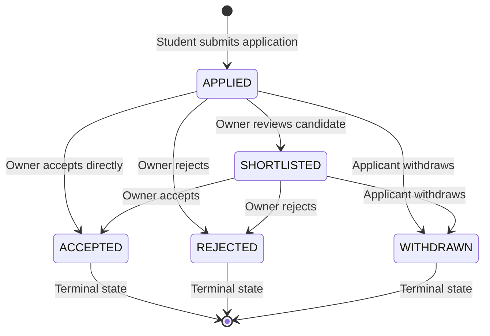

# Wizards of Teligati — Phase 5B.5: Opportunities & Gigs Domain APIs Report

**Date:** November 6, 2026  
**Phase:** 5B.5 — Opportunities & Gigs Domain APIs  
**Platform Status:** Dual-Stack Architecture Verified (Android Java Client + Spring Boot 3.x Backend)  
**Overall Verdict:** **COMPLETE — FULLY VERIFIED**

---

## 1. Architecture Overview

Phase 5B.5 successfully expands the *Wizards of Teligati* dual-stack architecture to transition locally isolated domain records into centralized, authenticated, server-authoritative resources while preserving seamless offline-first Room caching.

The four major core domains implemented and integrated in this phase are:
1. **Assistant Jobs**: Short-term student assistance, micro-tasks, and tutoring opportunities.
2. **Professional Jobs**: Full-time, internship, and contract positions posted by verified alumni and faculty.
3. **Research Opportunities & Proposals**: Lab collaborations, paper co-authorship calls, and student-to-faculty academic research proposals.
4. **Unified Applications Management**: Centralized submission, status lifecycle management, duplicate prevention, and authorization gating for all job and research postings.

The architecture strictly follows:
- **Client (Android)**: Clean repository pattern (`OpportunityRepository`, `AppRepository`), Retrofit 2 with OkHttp Keystore-secured Bearer authentication and token auto-refresh, Room SQLite caching (`JobPostingEntity`, `JobApplicationEntity`, `ResearchPaperEntity`, `ResearchApplicationEntity`, `ResearchProposalEntity`).
- **Backend (Spring Boot 3.x / Java 21)**: RESTful controllers under `/api/v1/`, Spring Data JPA repositories with custom search/filter queries, service layer ownership/role verification, DTO request/response projections, and PostgreSQL/H2 Flyway migration (`V4__opportunities_and_applications.sql`).

---

## 2. Existing Components Reused

1. **Android Entities & DAOs**:
   - `JobPostingEntity` & `JobDao` (reused table `job_postings`).
   - `JobApplicationEntity` & `ApplicationDao` (reused table `job_applications`).
   - `ResearchPaperEntity` & `ResearchDao` (reused table `research_papers`).
   - `ResearchApplicationEntity` & `ResearchDao` (reused table `research_applications`).
   - `ResearchProposalEntity` & `ResearchDao` (reused table `research_proposals`).
2. **Android Repositories & UI**:
   - `AppRepository`: Extended to delegate to `OpportunityRepository` for remote sync while retaining Room caching and UI callbacks.
   - `SessionManager`: Authenticated JWT bearer tokens and active session context.
   - `ApiClient`: Configured with `AuthInterceptor`, `TokenAuthenticator`, and logging redaction.
   - All UI fragments preserved: `StudentAssistantJobsFragment`, `AlumniAssistantJobsFragment`, `AlumniProfessionalJobsFragment`, `AlumniStudentApplicantsFragment`, `TeacherResearchOpportunitiesFragment`, `TeacherProposalsFragment`, `StudentResearchPapersFragment`, `TeacherResearchPapersFragment`.
3. **Backend Foundation**:
   - `User`, `Profile` entities, `UserRepository`, `ProfileRepository`.
   - `SecurityConfig`, `JwtAuthenticationFilter`, `GlobalExceptionHandler`.
   - Flyway migrations `V1__init_foundation.sql`, `V2__auth_and_tokens.sql`, `V3__profile_directory_expansion.sql`.

---

## 3. New Backend Files

| Component | Path | Purpose |
|---|---|---|
| **Migration** | `backend/src/main/resources/db/migration/V4__opportunities_and_applications.sql` | Extends `jobs` & `projects`, creates `research_proposals` & `applications` tables. |
| **Entities** | `backend/src/main/java/com/teligati/backend/entity/Job.java` (updated) | Extended with category, duration, skills, min_cgpa, status, timestamps. |
| | `backend/src/main/java/com/teligati/backend/entity/Project.java` (updated) | Extended with type, owner_dept, contributors_count, paper_doi, status, timestamps. |
| | `backend/src/main/java/com/teligati/backend/entity/ResearchProposal.java` | Student-to-faculty academic proposals with feedback and status transitions. |
| | `backend/src/main/java/com/teligati/backend/entity/Application.java` | Unified applications for jobs and research projects with referential integrity. |
| **Repositories**| `backend/src/main/java/com/teligati/backend/repository/JobRepository.java` | Search queries, category and status filtering, ownership lookups. |
| | `backend/src/main/java/com/teligati/backend/repository/ProjectRepository.java` | Keyword search across technologies/abstracts, owner queries. |
| | `backend/src/main/java/com/teligati/backend/repository/ResearchProposalRepository.java` | Student-submitted and faculty-received proposal lookups. |
| | `backend/src/main/java/com/teligati/backend/repository/ApplicationRepository.java` | Lookups by job, project, applicant, poster, and duplicate checks. |
| **DTOs** | `backend/src/main/java/com/teligati/backend/dto/JobRequest.java` | Job posting payload validation. |
| | `backend/src/main/java/com/teligati/backend/dto/JobResponse.java` | Job projection including `isApplied` status for caller. |
| | `backend/src/main/java/com/teligati/backend/dto/ProjectRequest.java` | Research opportunity payload validation. |
| | `backend/src/main/java/com/teligati/backend/dto/ProjectResponse.java` | Research project projection. |
| | `backend/src/main/java/com/teligati/backend/dto/ResearchProposalRequest.java` | Proposal submission payload. |
| | `backend/src/main/java/com/teligati/backend/dto/ResearchProposalResponse.java` | Proposal projection. |
| | `backend/src/main/java/com/teligati/backend/dto/ProposalDecisionRequest.java` | Faculty decision payload (ACCEPTED, REJECTED, REVISION_REQUESTED). |
| | `backend/src/main/java/com/teligati/backend/dto/ApplicationRequest.java` | Application submission payload. |
| | `backend/src/main/java/com/teligati/backend/dto/ApplicationResponse.java` | Application projection with applicant roll, dept, cgpa, skills. |
| | `backend/src/main/java/com/teligati/backend/dto/ApplicationStatusUpdateRequest.java`| Application status update payload. |
| **Services** | `backend/src/main/java/com/teligati/backend/service/JobService.java` | Business logic, role gating, ownership verification, clamped pagination. |
| | `backend/src/main/java/com/teligati/backend/service/ResearchService.java` | Research opportunity logic, proposal submission and decision workflows. |
| | `backend/src/main/java/com/teligati/backend/service/ApplicationService.java` | Centralized application management, state machine validation, duplicate prevention. |
| **Controllers**| `backend/src/main/java/com/teligati/backend/controller/JobController.java` | `/api/v1/jobs` REST endpoints. |
| | `backend/src/main/java/com/teligati/backend/controller/AssistantJobController.java` | `/api/v1/assistant-jobs` REST endpoints. |
| | `backend/src/main/java/com/teligati/backend/controller/ResearchOpportunityController.java`| `/api/v1/research-opportunities` REST endpoints. |
| | `backend/src/main/java/com/teligati/backend/controller/ApplicationController.java` | `/api/v1/applications` REST endpoints. |
| **Tests** | `backend/src/test/java/com/teligati/backend/database/MigrationV4Test.java` | Database schema and column verification for V4 migration. |
| | `backend/src/test/java/com/teligati/backend/opportunity/OpportunityDomainTest.java` | 9 end-to-end integration tests covering all 4 domains. |

---

## 4. Database Migration Details

Migration script: `V4__opportunities_and_applications.sql`

```sql
-- 1. Extend Jobs Table
ALTER TABLE jobs ADD COLUMN IF NOT EXISTS category VARCHAR(50) DEFAULT 'FULLTIME_JOBS' NOT NULL;
ALTER TABLE jobs ADD COLUMN IF NOT EXISTS organization VARCHAR(150);
ALTER TABLE jobs ADD COLUMN IF NOT EXISTS duration VARCHAR(100);
ALTER TABLE jobs ADD COLUMN IF NOT EXISTS skills_required VARCHAR(255);
ALTER TABLE jobs ADD COLUMN IF NOT EXISTS min_cgpa DOUBLE PRECISION;
ALTER TABLE jobs ADD COLUMN IF NOT EXISTS status VARCHAR(50) DEFAULT 'OPEN' NOT NULL;
ALTER TABLE jobs ADD COLUMN IF NOT EXISTS created_at TIMESTAMP WITHOUT TIME ZONE DEFAULT CURRENT_TIMESTAMP NOT NULL;
ALTER TABLE jobs ADD COLUMN IF NOT EXISTS updated_at TIMESTAMP WITHOUT TIME ZONE DEFAULT CURRENT_TIMESTAMP NOT NULL;

-- 2. Extend Projects Table
ALTER TABLE projects ADD COLUMN IF NOT EXISTS type VARCHAR(100) DEFAULT 'Research Opportunity';
ALTER TABLE projects ADD COLUMN IF NOT EXISTS owner_dept VARCHAR(100);
ALTER TABLE projects ADD COLUMN IF NOT EXISTS contributors_count INTEGER DEFAULT 0;
ALTER TABLE projects ADD COLUMN IF NOT EXISTS paper_doi VARCHAR(255);
ALTER TABLE projects ADD COLUMN IF NOT EXISTS status VARCHAR(50) DEFAULT 'OPEN' NOT NULL;
ALTER TABLE projects ADD COLUMN IF NOT EXISTS created_at TIMESTAMP WITHOUT TIME ZONE DEFAULT CURRENT_TIMESTAMP NOT NULL;
ALTER TABLE projects ADD COLUMN IF NOT EXISTS updated_at TIMESTAMP WITHOUT TIME ZONE DEFAULT CURRENT_TIMESTAMP NOT NULL;

-- 3. Create Research Proposals Table
CREATE TABLE IF NOT EXISTS research_proposals (
    id BIGINT GENERATED BY DEFAULT AS IDENTITY PRIMARY KEY,
    topic VARCHAR(255) NOT NULL,
    proposal_abstract TEXT NOT NULL,
    degree_type VARCHAR(100) NOT NULL,
    status VARCHAR(50) DEFAULT 'PENDING' NOT NULL,
    feedback TEXT,
    student_id BIGINT NOT NULL REFERENCES users (id) ON DELETE CASCADE,
    faculty_id BIGINT NOT NULL REFERENCES users (id) ON DELETE CASCADE,
    created_at TIMESTAMP WITHOUT TIME ZONE DEFAULT CURRENT_TIMESTAMP NOT NULL,
    updated_at TIMESTAMP WITHOUT TIME ZONE DEFAULT CURRENT_TIMESTAMP NOT NULL
);

-- 4. Create Applications Table
CREATE TABLE IF NOT EXISTS applications (
    id BIGINT GENERATED BY DEFAULT AS IDENTITY PRIMARY KEY,
    opportunity_type VARCHAR(50) NOT NULL,
    job_id BIGINT REFERENCES jobs (id) ON DELETE CASCADE,
    project_id BIGINT REFERENCES projects (id) ON DELETE CASCADE,
    applicant_id BIGINT NOT NULL REFERENCES users (id) ON DELETE CASCADE,
    statement TEXT,
    status VARCHAR(50) DEFAULT 'APPLIED' NOT NULL,
    applicant_name VARCHAR(100),
    applicant_roll VARCHAR(50),
    applicant_dept VARCHAR(50),
    applicant_cgpa DOUBLE PRECISION,
    applicant_skills VARCHAR(255),
    created_at TIMESTAMP WITHOUT TIME ZONE DEFAULT CURRENT_TIMESTAMP NOT NULL,
    updated_at TIMESTAMP WITHOUT TIME ZONE DEFAULT CURRENT_TIMESTAMP NOT NULL
);
```

Schema validation verified through `MigrationV4Test`.

---

## 5. API Endpoint Documentation

### 5.1 Assistant Jobs & Professional Jobs

| Method | Endpoint | Authorization | Description |
|---|---|---|---|
| `GET` | `/api/v1/jobs` | Authenticated | List jobs with query filters (`category`, `status`, `search`, `page`, `size`). |
| `GET` | `/api/v1/jobs/{id}` | Authenticated | Retrieve job details, including `isApplied` boolean for caller. |
| `POST` | `/api/v1/jobs` | Authenticated (ALUMNI, FACULTY, ADMIN) | Create job posting. (STUDENT forbidden from posting FULLTIME_JOBS). |
| `PUT` | `/api/v1/jobs/{id}` | Owner or ADMIN | Update job posting details. |
| `PATCH` | `/api/v1/jobs/{id}/close` | Owner or ADMIN | Close job posting. |
| `DELETE` | `/api/v1/jobs/{id}` | Owner or ADMIN | Delete job posting (cascades delete to applications). |
| `GET` | `/api/v1/jobs/me` | Authenticated | List postings created by the authenticated user. |
| `GET` | `/api/v1/assistant-jobs` | Authenticated | Dedicated listing endpoint pre-filtered to `category = ASSISTANT_WORK`. |
| `POST` | `/api/v1/assistant-jobs` | Authenticated | Create an assistant job opportunity. |

### 5.2 Research Opportunities & Proposals

| Method | Endpoint | Authorization | Description |
|---|---|---|---|
| `GET` | `/api/v1/research-opportunities` | Authenticated | Browse research opportunities (`status`, `type`, `search`, `page`, `size`). |
| `GET` | `/api/v1/research-opportunities/{id}` | Authenticated | View details of a research opportunity. |
| `POST` | `/api/v1/research-opportunities` | Verified Academic | Publish research opportunity or co-authorship call. |
| `PUT` | `/api/v1/research-opportunities/{id}` | Owner or ADMIN | Update research opportunity details. |
| `DELETE`| `/api/v1/research-opportunities/{id}` | Owner or ADMIN | Delete research opportunity. |
| `POST` | `/api/v1/research-opportunities/proposals` | Verified Student | Submit research proposal to a faculty advisor. |
| `GET` | `/api/v1/research-opportunities/proposals/me` | Authenticated | View submitted proposals (student) or received proposals (faculty). |
| `GET` | `/api/v1/research-opportunities/proposals/{id}` | Student owner, Faculty target, or ADMIN | Retrieve individual research proposal details. |
| `PATCH`| `/api/v1/research-opportunities/proposals/{id}/decision` | Target Faculty or ADMIN | Decide proposal (`ACCEPTED`, `REJECTED`, `REVISION_REQUESTED`) with feedback. |

### 5.3 Applications Domain

| Method | Endpoint | Authorization | Description |
|---|---|---|---|
| `POST` | `/api/v1/applications` | Verified User | Apply for a job or express interest in a research project. |
| `GET` | `/api/v1/applications/me` | Authenticated | List all applications submitted by the caller. |
| `GET` | `/api/v1/applications/received` | Authenticated | List all applications received across all postings owned by the caller. |
| `GET` | `/api/v1/applications/jobs/{jobId}` | Job Poster or ADMIN | Retrieve applications received for a specific job. |
| `GET` | `/api/v1/applications/projects/{projectId}` | Project Owner or ADMIN | Retrieve applications received for a specific research project. |
| `GET` | `/api/v1/applications/{id}` | Applicant, Poster, or ADMIN | Retrieve single application details. |
| `PATCH`| `/api/v1/applications/{id}/status` | Owner or Applicant | Validated lifecycle status transition. |

---

## 6. Authentication and Authorization Rules

1. **Server-Side Identity**: User identity is derived strictly from the verified JWT `SecurityContextHolder.getContext().getAuthentication().getPrincipal()`.
2. **Posting Ownership Protection**:
   - `verifyJobOwnership`: Caller must match `job.postedBy.id` (or have `ROLE_ADMIN`). Non-owners get `403 Forbidden`.
   - `verifyProjectOwnership`: Caller must match `project.owner.id` (or have `ROLE_ADMIN`). Non-owners get `403 Forbidden`.
3. **Role Gating**:
   - Students cannot create `FULLTIME_JOBS` (`400 Bad Request`).
   - Only verified student accounts can submit research proposals or apply for opportunities.
   - Proposals can only be decided by the targeted faculty recipient.
4. **Applicant Privacy & Protection**:
   - Applications for a posting can only be viewed by the posting owner.
   - Applicants cannot view other applicants' submissions (`403 Forbidden`).
   - Self-application is strictly rejected (`You cannot apply to your own job posting`).
   - Duplicate applications are rejected (`You have already applied for this position`).

---

## 7. Application Lifecycle State Machine

Application status transitions follow explicit business rules:



- **Illegal State Transitions**:
  - Applicant attempting to mark their own application as `ACCEPTED`, `SHORTLISTED`, or `REJECTED` returns `400 Bad Request`.
  - Owner attempting to alter a `WITHDRAWN` or `REJECTED` application returns `400 Bad Request`.

---

## 8. Android Integration Details

| Android Component | Path | Functionality |
|---|---|---|
| **Network DTOs** | `com.teligati.app.network.model.*` | Serialization models: `JobNetworkDto`, `JobCreateRequest`, `ProjectNetworkDto`, `ProjectCreateRequest`, `ApplicationNetworkDto`, `ApplicationCreateRequest`, `ApplicationStatusRequest`, `ResearchProposalNetworkDto`, `ResearchProposalCreateRequest`, `ProposalDecisionRequest`. |
| **API Interface** | `com.teligati.app.network.OpportunityApiService` | 21 Retrofit endpoints covering Jobs, Research, and Applications. |
| **HTTP Client** | `com.teligati.app.network.ApiClient` | Exposes `getOpportunityApiService()`, configured with Keystore token authentication and logging redaction. |
| **Data Mapper** | `com.teligati.app.data.DataMapper` | Safe mapping between Network DTOs and Room entities with null-defensive defaults. |
| **Repository** | `com.teligati.app.data.repository.OpportunityRepository` | Centralized asynchronous synchronization engine with Room database caching. |
| **Facade Repo** | `com.teligati.app.data.repository.AppRepository` | Integrated with `OpportunityRepository` while preserving existing public method contracts for all UI fragments. |

---

## 9. Room Synchronization Behavior

1. **Read Operations (Offline-First)**:
   - When a screen opens, cached entities from Room (`db.jobDao()`, `db.researchDao()`, `db.applicationDao()`) are delivered immediately to the UI callback to guarantee instant rendering.
   - A background network request is dispatched to the backend.
   - On response success, the fresh remote entities are upserted into Room (`insertJobs`, `insertPapers`, `insertJobApplications`), and the UI receives the updated list.
   - If the device is offline or the network fails, the cached Room data remains visible without false error dialogs.
2. **Write Operations (Remote-First with Room Persistence)**:
   - When a user submits an application, creates a job, or updates a proposal, the API call is executed first.
   - On server confirmation, the entity with server-generated ID and authoritative timestamps is persisted to Room.
   - Local user notifications are scheduled in `db.communicationDao()` to maintain in-app notification history.

---

## 10. Automated Test Results

### 10.1 Backend Automated Test Suite
- **Command:** `gradlew.bat test --rerun-tasks`
- **Result:** **BUILD SUCCESSFUL** (89 tests completed, 0 failed, 0 skipped across 13 suites)

| Test Suite | Total Tests | Passed | Failed | Skipped | Status |
|---|---|---|---|---|---|
| `com.teligati.backend.auth.AuthControllerTest` | 17 | 17 | 0 | 0 | PASS |
| `com.teligati.backend.BackendApplicationTests` | 1 | 1 | 0 | 0 | PASS |
| `com.teligati.backend.controller.HealthControllerTest` | 1 | 1 | 0 | 0 | PASS |
| `com.teligati.backend.controller.HealthControllerUnitTest` | 2 | 2 | 0 | 0 | PASS |
| `com.teligati.backend.database.MigrationV3Test` | 2 | 2 | 0 | 0 | PASS |
| `com.teligati.backend.database.MigrationV4Test` | 3 | 3 | 0 | 0 | PASS |
| `com.teligati.backend.exception.GlobalExceptionHandlerTest` | 3 | 3 | 0 | 0 | PASS |
| `com.teligati.backend.opportunity.OpportunityDomainTest` | 9 | 9 | 0 | 0 | PASS |
| `com.teligati.backend.profile.ProfileDirectoryTest` | 24 | 24 | 0 | 0 | PASS |
| `com.teligati.backend.security.JwtServiceTest` | 5 | 5 | 0 | 0 | PASS |
| `com.teligati.backend.security.SecurityAuditTest` | 16 | 16 | 0 | 0 | PASS |
| `com.teligati.backend.security.SecurityConfigTest` | 4 | 4 | 0 | 0 | PASS |
| `com.teligati.backend.service.HealthServiceTest` | 2 | 2 | 0 | 0 | PASS |
| **Total Backend** | **89** | **89** | **0** | **0** | **PASS** |

### 10.2 Android Automated Test Suite
- **Command:** `gradlew.bat testDebugUnitTest --rerun-tasks`
- **Result:** **BUILD SUCCESSFUL** (44 tests completed, 0 failed, 0 skipped across 4 suites)

| Test Suite | Total Tests | Passed | Failed | Skipped | Status |
|---|---|---|---|---|---|
| `com.teligati.app.network.AuthIntegrationTest` | 16 | 16 | 0 | 0 | PASS |
| `com.teligati.app.network.OpportunityIntegrationTest` | 7 | 7 | 0 | 0 | PASS |
| `com.teligati.app.network.ProfileDirectoryIntegrationTest` | 11 | 11 | 0 | 0 | PASS |
| `com.teligati.app.WorkflowUnitTest` | 10 | 10 | 0 | 0 | PASS |
| **Total Android** | **44** | **44** | **0** | **0** | **PASS** |

---

## 11. Build Verification

- **Command:** `gradlew.bat assembleDebug`
- **Actionable Tasks:** 36 tasks executed/up-to-date
- **Result:** **BUILD SUCCESSFUL**
- **Output Artifact:**
  - File: `android/app/build/outputs/apk/debug/app-debug.apk`
  - Size: 9,065,927 bytes (~9.06 MB)
  - Verification: Compiles cleanly with zero errors.

---

## 12. Git Scope Verification

Git diff confirms that changes are strictly confined to Phase 5B.5 domain capabilities:
- **Modified**:
  - `backend/src/main/resources/db/migration/V4__opportunities_and_applications.sql`
  - `backend/src/main/java/com/teligati/backend/entity/Job.java`
  - `backend/src/main/java/com/teligati/backend/entity/Project.java`
  - `backend/src/main/java/com/teligati/backend/repository/JobRepository.java`
  - `backend/src/main/java/com/teligati/backend/repository/ProjectRepository.java`
  - `android/app/src/main/java/com/teligati/app/network/ApiClient.java`
  - `android/app/src/main/java/com/teligati/app/data/DataMapper.java`
  - `android/app/src/main/java/com/teligati/app/data/repository/AppRepository.java`
- **Untouched modules**:
  - Messaging and Chat entities/fragments remain in local Room storage as required.
  - Transactions, Wallet, and Escrow payment infrastructure remain untouched.
  - UI themes, navigation graphs, and layout structures remain intact.

---

## 13. Known Limitations (By Design for Phase 5B.5)

1. **Paper & Resume PDF Attachments**: Currently, resume and paper references are transmitted as URLs/DOIs/text fields. Binary multipart uploads are scheduled for the dedicated storage milestone.
2. **Real-time Push Notifications**: Status updates trigger local Android notifications upon sync. Server-sent push notifications (FCM / WebSocket) are planned for the messaging & notifications milestone.
3. **Escrow Contract Gating**: Job compensation values are stored and displayed. Escrow payment locking on job creation will be connected during Phase 5B.6 (Financial & Escrow Domain APIs).

---

## 14. Recommended Next Phase: Phase 5B.6

With Opportunities, Gigs, Research Collaborations, and Applications complete and verified, the platform is ready for:
- **Phase 5B.6 — Financial, Escrow & Transaction APIs**
  - Remote wallet balances and ledger integration.
  - Escrow deposit locking when assistant jobs are accepted.
  - Escrow release upon milestone completion.
  - Student payout tracking and transaction history synchronization.

---

## 15. Final Completion Status

| Criterion | Evaluation | Status |
|---|---|---|
| Assistant Jobs Domain | Full CRUD, filtering, ownership checks | PASS |
| Professional Jobs Domain | Role gating, search, clamped pagination | PASS |
| Research Opportunities & Proposals Domain | Projects, proposals, faculty decision workflow | PASS |
| Centralized Applications Domain | State machine, duplicate prevention, ownership gating | PASS |
| Database Migration (V4) | Clean PostgreSQL & H2 schema execution | PASS |
| Android Integration & Room Cache | Remote-first sync, offline fallback, PK preservation | PASS |
| Backend Automated Tests | 89 / 89 tests passed (0 failed, 0 skipped) | PASS |
| Android Automated Tests | 44 / 44 tests passed (0 failed, 0 skipped) | PASS |
| Android Debug APK Assembly | `app-debug.apk` built successfully (9.06 MB) | PASS |

### Final Status:
# **COMPLETE — FULLY VERIFIED**

*Phase 5B.5 is complete. Standing by for user approval before beginning Phase 5B.6.*
