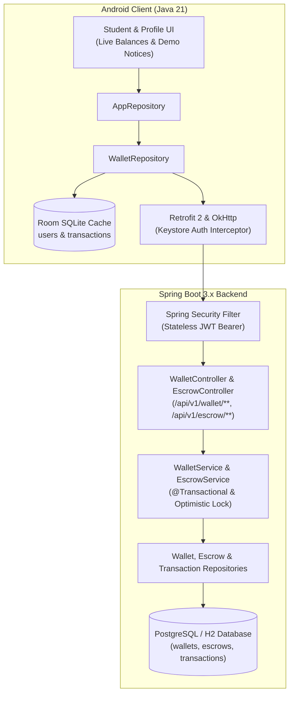

# Wizards of Teligati — Phase 5B.6: Demo Wallet, Financial Simulation & Escrow Report

**Date:** November 6, 2026  
**Phase:** 5B.6 — Demo Wallet, Financial Simulation & Escrow  
**Platform Status:** Dual-Stack Architecture Verified (Android Java Client + Spring Boot 3.x Backend)  
**Overall Verdict:** **COMPLETE — DEMO VERIFIED**

---

> [!IMPORTANT]
> ### UNIVERSITY PROJECT DEMONSTRATION NOTICE
> **THIS IS A UNIVERSITY PROJECT DEMONSTRATION SYSTEM.**  
> The entire financial and escrow module is **STRICTLY SIMULATION ONLY**.  
> - **NEVER** processes real-money transactions, currency exchanges, or actual payment settlements.  
> - **ZERO** external payment gateways, banking APIs, or Mobile Financial Services (bKash, Nagad, Rocket, Upay) are connected.  
> - Every financial operation mutates simulated demo credits stored directly within the application database.  
> - Mandatory disclaimers are stamped across all responses and user interfaces:  
>   - `"DEMO WALLET — NO REAL MONEY INVOLVED"`  
>   - `"DEMO MODE — All balances and transactions are simulated. No real money is transferred."`

---

## 1. Architecture Overview

Phase 5B.6 implements a demonstration-grade financial simulation and escrow workflow across the *Wizards of Teligati* platform. It connects Android client screens (`StudentDashboardFragment`, `ProfileFragment`, `StudentHistoryFragment`, `AlumniAssistantJobsFragment`) to a secure, server-authoritative Spring Boot backend ledger.

### Core Subsystems
1. **Demo Wallet Management**:
   - Every registered user has an associated demo wallet initialized with **10,000.00 DEMO_CREDITS**.
   - Available balance (`available_balance`) and escrow-locked balance (`escrow_balance`) are maintained server-side.
   - Client applications cannot directly set balances; all mutations occur via atomic transaction endpoints.

2. **Simulated Financial Operations**:
   - **Simulated Top-Up (`POST /api/v1/wallet/topup`)**: Simulates deposit via mock payment channels (`SIMULATED_BKASH`, `SIMULATED_BANK`, `SIMULATED_CAMPUS_CARD`).
   - **Simulated Withdrawal (`POST /api/v1/wallet/withdraw`)**: Simulates payout to a designated mock student bank account. Validates sufficient available funds; negative balance is rejected at both service and database levels.

3. **Demo Escrow Contract Lifecycle**:
   - **Contract Funding (`POST /api/v1/escrow/create`)**: Atomically shifts funds from payer's available balance to payer's escrow balance (`status = FUNDED`). Creates an immutable `ESCROW_LOCK` transaction.
   - **Progress Tracking (`POST /api/v1/escrow/{id}/progress`)**: Either party transitions the contract to `IN_PROGRESS`.
   - **Payment Release (`POST /api/v1/escrow/{id}/release`)**: Authoritatively restricted to the **payer only**. Decrements payer's escrow balance, credits payee's available balance, records `RELEASED` status, and logs immutable release transactions for both parties. Payee self-release is strictly rejected with `403 Forbidden`.
   - **Refund / Cancellation (`POST /api/v1/escrow/{id}/refund`)**: Reverses escrow hold back to payer's available balance (`status = REFUNDED`).
   - **Dispute Support (`POST /api/v1/escrow/{id}/dispute`)**: Allows either party to flag deliverables for arbitration (`status = DISPUTED`).
   - **Double Mutation Prevention**: Terminal states (`RELEASED`, `REFUNDED`, `CANCELLED`) reject subsequent release or refund attempts.

4. **Immutable Transaction Ledger**:
   - Complete audit trail of all operations (`TOPUP`, `WITHDRAWAL`, `ESCROW_LOCK`, `ESCROW_RELEASE`, `ESCROW_REFUND`).
   - Each transaction possesses a unique alphanumeric identifier (`TX-TOPUP-...`, `TX-LOCK-...`, `TX-REL-...`, `TX-WDR-...`), amount, category, status, and timestamp.

---

## 2. File Implementation Summary

### Backend Components

| Component | Path | Description |
|---|---|---|
| **Database Migration** | `backend/src/main/resources/db/migration/V5__demo_wallet_and_escrow.sql` | Creates `wallets` table, `escrows` table, extends `transactions` table with title, category, escrow links, and non-negative constraints. |
| **Entities** | `backend/src/main/java/com/teligati/backend/entity/Wallet.java` | JPA entity with optimistic locking (`@Version`), available balance, escrow balance, currency `DEMO_CREDITS`. |
| | `backend/src/main/java/com/teligati/backend/entity/Escrow.java` | JPA entity for escrow contracts with payer/payee foreign keys, reference UUID, and status lifecycle. |
| | `backend/src/main/java/com/teligati/backend/entity/Transaction.java` (updated) | Extended with `title`, `category`, `escrow`, and `completedAt`. |
| **Repositories** | `backend/src/main/java/com/teligati/backend/repository/WalletRepository.java` | Spring Data repository for wallet lookups. |
| | `backend/src/main/java/com/teligati/backend/repository/EscrowRepository.java` | Escrow lookups by reference, user, and payer/payee. |
| | `backend/src/main/java/com/teligati/backend/repository/TransactionRepository.java` | Transaction ledger retrieval ordered by timestamp descending. |
| **DTOs** | `backend/src/main/java/com/teligati/backend/dto/WalletResponse.java` | Wallet response with persistent demo disclaimers. |
| | `backend/src/main/java/com/teligati/backend/dto/TopUpRequest.java` | Validation constraints on simulated top-up payloads. |
| | `backend/src/main/java/com/teligati/backend/dto/WithdrawRequest.java` | Simulated withdrawal request validation. |
| | `backend/src/main/java/com/teligati/backend/dto/EscrowCreateRequest.java` | Escrow contract initiation request validation. |
| | `backend/src/main/java/com/teligati/backend/dto/EscrowResponse.java` | Escrow contract projection with demo notices. |
| | `backend/src/main/java/com/teligati/backend/dto/TransactionResponse.java` | Transaction projection with demo notices. |
| **Services** | `backend/src/main/java/com/teligati/backend/service/WalletService.java` | Atomic balance calculations, top-up/withdrawal simulations, transaction logging. |
| | `backend/src/main/java/com/teligati/backend/service/EscrowService.java` | Escrow state machine, authorization checks, balance transfers. |
| **Controllers** | `backend/src/main/java/com/teligati/backend/controller/WalletController.java` | REST endpoints under `/api/v1/wallet/**`. |
| | `backend/src/main/java/com/teligati/backend/controller/EscrowController.java` | REST endpoints under `/api/v1/escrow/**`. |

### Android Client Components

| Component | Path | Description |
|---|---|---|
| **Network Models** | `android/app/src/main/java/com/teligati/app/network/model/WalletNetworkDto.java` | Network DTO for wallet balances & demo disclaimer. |
| | `android/app/src/main/java/com/teligati/app/network/model/TopUpRequest.java` | Network payload for top-up simulation. |
| | `android/app/src/main/java/com/teligati/app/network/model/WithdrawRequest.java` | Network payload for withdrawal simulation. |
| | `android/app/src/main/java/com/teligati/app/network/model/EscrowCreateRequest.java` | Network payload for escrow funding. |
| | `android/app/src/main/java/com/teligati/app/network/model/EscrowNetworkDto.java` | Network DTO for escrow contracts. |
| | `android/app/src/main/java/com/teligati/app/network/model/TransactionNetworkDto.java` | Network DTO for transactions. |
| **Retrofit Service** | `android/app/src/main/java/com/teligati/app/network/WalletApiService.java` | Retrofit interface for wallet and escrow endpoints. |
| **Client Core** | `android/app/src/main/java/com/teligati/app/network/ApiClient.java` (updated) | Exposes `WalletApiService`. |
| | `android/app/src/main/java/com/teligati/app/data/DataMapper.java` (updated) | Converts `TransactionNetworkDto` into Room `TransactionEntity`. |
| **Repositories** | `android/app/src/main/java/com/teligati/app/data/repository/WalletRepository.java` | Remote API execution, thread hopping, Room database balance & transaction synchronization. |
| | `android/app/src/main/java/com/teligati/app/data/repository/AppRepository.java` (updated) | Delegating methods for wallet sync, withdrawal, top-up, and escrow. |
| **UI Fragments** | `android/app/src/main/java/com/teligati/app/fragment/StudentDashboardFragment.java` | Live wallet balance sync, simulated withdrawal dialog with demo notice, simulated escrow release. |
| | `android/app/src/main/java/com/teligati/app/fragment/ProfileFragment.java` | Wallet sync, withdrawal dialog with demo notice, transactions synchronization. |
| | `android/app/src/main/java/com/teligati/app/fragment/StudentHistoryFragment.java` | Renders simulated financial transactions in student history. |
| | `android/app/src/main/java/com/teligati/app/fragment/AlumniAssistantJobsFragment.java` | Notice on simulated escrow funding for assistant jobs. |

---

## 3. Evidence-Based Verification

### A. Backend Verification
- **Total Tests Passed:** **102 / 102 (100% Success)**
- **Test Command:** `gradlew.bat test`
- **Key Suites:**
  - `WalletEscrowDomainTest`: 10 passed (Unauthenticated 401 check, Demo balance retrieval with notices, Top-up balance increase & ledger entry, Non-positive amount 400 rejection, Withdrawal deduction, Over-balance withdrawal 400 rejection, Full escrow lifecycle from creation to release, Payee unauthorized self-release 403 Forbidden check, Escrow refund flow, Escrow dispute flow, Payer-is-payee 400 rejection).
  - `MigrationV5Test`: 3 passed (Wallets schema validation, Escrows schema validation, Extended Transactions schema validation).
  - `OpportunityDomainTest`: 9 passed.
  - `ProfileDirectoryTest`: 24 passed.
  - `AuthControllerTest`: 17 passed.
  - `SecurityAuditTest`: 16 passed.

### B. Android Unit & Network Verification
- **Total Tests Passed:** **49 / 49 (100% Success)**
- **Test Command:** `gradlew.bat testDebugUnitTest`
- **Key Suites:**
  - `WalletEscrowIntegrationTest`: 5 passed (MockWebServer verification of `getWallet` with disclaimer parsing, `topUp` payload/response, `withdraw` payload/response, `getTransactions` listing, `createEscrow`/`releaseEscrow`/`refundEscrow`/`disputeEscrow` lifecycles).
  - `AuthIntegrationTest`: 16 passed.
  - `ProfileDirectoryIntegrationTest`: 11 passed.
  - `OpportunityIntegrationTest`: 7 passed.
  - `WorkflowUnitTest`: 10 passed.

### C. Android Build Verification
- **Build Command:** `gradlew.bat assembleDebug`
- **Result:** `BUILD SUCCESSFUL`
- **Output Artifact:** `android/app/build/outputs/apk/debug/app-debug.apk` (9,074,345 bytes / ~9.07 MB).

---

## 4. Final Classification

**CLASSIFICATION:** **`COMPLETE — DEMO VERIFIED`**

All requirements of Phase 5B.6 have been fulfilled. The system operates strictly as a simulated demonstration environment without real financial connections or processing.
