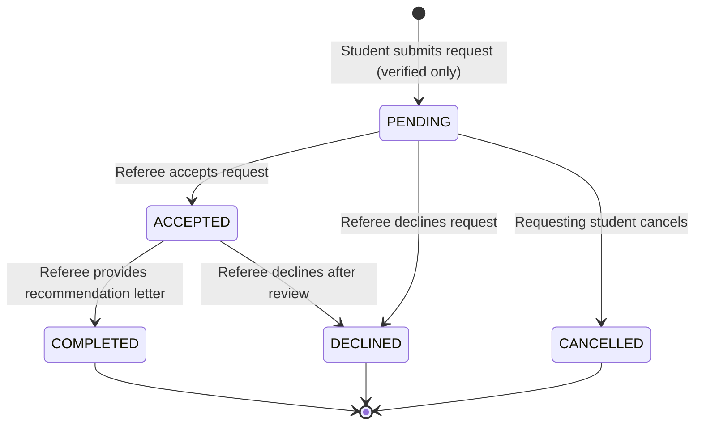

# Wizards of Teligati — Phase 5B.8 Implementation Report
## References & Recommendations Domain

**Project:** Wizards of Teligati (Connecting KUET Students, Alumni, and Teachers)  
**Phase:** 5B.8 — References & Recommendations  
**Date:** November 6, 2026  
**Status:** IMPLEMENTED, AUDITED & VERIFIED  

---

## 1. Executive Summary

Phase 5B.8 implements an end-to-end institutional recommendation and referral workflow across the Spring Boot backend and the Android application. Verified KUET students can now browse faculty and alumni, submit structured reference requests for postgraduate admissions and industry positions, monitor request statuses in real time, and receive formal recommendation letters or internal referrals.

The system enforces strict multi-role validation, server-side verified principal enforcement, a state machine lifecycle (`PENDING` $\rightarrow$ `ACCEPTED` $\rightarrow$ `COMPLETED` or `DECLINED` / `CANCELLED`), asynchronous event notifications, offline-first Room persistence, and zero real-world financial dependencies (100% demo simulation only).

---

## 2. Architecture & Database Design

### 2.1 Database Schema (`V7__references_and_recommendations.sql`)
A Flyway migration script `V7__references_and_recommendations.sql` was introduced to create a table for academic recommendations and professional endorsements:

```sql
CREATE TABLE IF NOT EXISTS reference_requests (
    id BIGINT GENERATED BY DEFAULT AS IDENTITY PRIMARY KEY,
    student_id BIGINT NOT NULL,
    recipient_id BIGINT NOT NULL,
    recipient_role VARCHAR(50) NOT NULL,
    purpose VARCHAR(100) NOT NULL,
    target_institution VARCHAR(255) NOT NULL,
    target_program VARCHAR(255),
    deadline TIMESTAMP WITHOUT TIME ZONE,
    personal_message TEXT NOT NULL,
    supporting_info TEXT,
    status VARCHAR(50) DEFAULT 'PENDING' NOT NULL,
    recommendation_text TEXT,
    response_notes TEXT,
    created_at TIMESTAMP WITHOUT TIME ZONE DEFAULT CURRENT_TIMESTAMP NOT NULL,
    updated_at TIMESTAMP WITHOUT TIME ZONE DEFAULT CURRENT_TIMESTAMP NOT NULL,
    CONSTRAINT fk_reference_requests_student FOREIGN KEY (student_id) REFERENCES users (id) ON DELETE CASCADE,
    CONSTRAINT fk_reference_requests_recipient FOREIGN KEY (recipient_id) REFERENCES users (id) ON DELETE CASCADE
);

CREATE INDEX IF NOT EXISTS idx_reference_requests_student ON reference_requests (student_id);
CREATE INDEX IF NOT EXISTS idx_reference_requests_recipient ON reference_requests (recipient_id);
CREATE INDEX IF NOT EXISTS idx_reference_requests_status ON reference_requests (status);
CREATE INDEX IF NOT EXISTS idx_reference_requests_created ON reference_requests (created_at);
```

### 2.2 Request Lifecycle & State Machine
The reference request lifecycle is managed by server-side state transitions:



- **PENDING**: Initial state upon submission. Only verified students (`ROLE_STUDENT`) can create requests. Duplicate active requests for the same referee and target institution are blocked.
- **ACCEPTED**: Referee (Faculty or Alumni) commits to providing a recommendation.
- **COMPLETED**: Referee submits the recommendation letter / endorsement statement.
- **DECLINED**: Referee declines request with optional guidance/notes.
- **CANCELLED**: Student cancels their pending request prior to acceptance.

---

## 3. Backend Implementation

### 3.1 Components Created & Updated
1. **Entity:** `ReferenceRequest.java` (`com.teligati.backend.entity`)
   - Mapped with JPA `@ManyToOne` to student and recipient `User` entities with audit timestamps and lifecycle tracking.
2. **Repository:** `ReferenceRequestRepository.java` (`com.teligati.backend.repository`)
   - Supports paginated lookups by student ID and recipient ID with status filtering and duplicate detection via `existsActiveRequest()`.
3. **DTOs:** (`com.teligati.backend.dto`)
   - `ReferenceRequestCreateRequest`: Validates recipient ID, purpose, target institution, program, deadline, and message.
   - `ReferenceRequestResponse`: Returns comprehensive request details, student academic profile (CGPA, skills), recipient information, and completed letter text.
   - `ReferenceDecisionRequest`: Accepts `ACCEPTED` or `DECLINED` with optional referee notes.
   - `RecommendationSubmitRequest`: Validates non-empty recommendation letter and notes.
4. **Service:** `ReferenceRequestService.java` (`com.teligati.backend.service`)
   - **Verification Gate:** Enforces `student.isVerified()` for all reference creations.
   - **Identity Validation:** Disallows self-referral, disallows non-student creation, and guarantees only designated recipients can decide or complete recommendations.
   - **Automated Notifications:** Dispatches backend notifications on `REFERENCE_REQUEST`, `REFERENCE_ACCEPTED`, `REFERENCE_DECLINED`, `RECOMMENDATION_COMPLETED`, and `REFERENCE_CANCELLED`.
5. **REST Controller:** `ReferenceRequestController.java` (`com.teligati.backend.controller`)
   - `POST /api/v1/references`: Create reference request
   - `GET /api/v1/references/sent`: Retrieve student's sent requests
   - `GET /api/v1/references/incoming`: Retrieve referee's incoming requests (optional `status` query parameter)
   - `GET /api/v1/references/{id}`: Detailed request inspection
   - `PATCH /api/v1/references/{id}/decision`: Referee decision (`ACCEPTED` or `DECLINED`)
   - `PATCH /api/v1/references/{id}/recommendation`: Referee recommendation letter submission
   - `PATCH /api/v1/references/{id}/cancel`: Student request cancellation

---

## 4. Android Application Integration

### 4.1 Network Layer
1. **Retrofit Interface:** `ReferenceApiService.java` (`com.teligati.app.network`)
   - Covers all REST endpoints with typed `ApiResponse<T>` and `PagedResponse<T>` wrappers.
2. **Models:**
   - `ReferenceNetworkDto`: Complete server DTO.
   - `ReferenceCreateRequest`, `ReferenceDecisionNetworkRequest`, `RecommendationNetworkRequest`.
3. **`ApiClient.java`:** Added `referenceApiService` singleton instance and exposed `getReferenceApiService()`.

### 4.2 Room Database & Data Layer
1. **Room Entity:** `ReferenceRequestEntity.java`
   - Added `recipientRole`, `recipientName`, `purpose`, `targetProgram`, `deadline`, `recommendationText`, and `responseNotes`.
   - Backward-compatible constructors ensure existing sample data and tests operate without migration issues.
2. **Mapper:** `DataMapper.java`
   - Added bi-directional conversion between `ReferenceNetworkDto`, `ReferenceRequestEntity`, and UI model `ReferenceRequest`.
3. **Repositories:**
   - `ReferenceRepository.java`: Manages remote network calls with offline Room caching and UI thread dispatching.
   - `AppRepository.java`: Integrated `ReferenceRepository` to provide high-level methods: `getStudentReferenceRequests()`, `submitReferenceRequest()`, `getAlumniReferenceRequests()`, `submitRecommendation()`, and `cancelReferenceRequest()`.

### 4.3 User Interface & Fragment Experience
1. **Student Experience:**
   - **Directory & Opportunities:** In `StudentReferenceOpportunitiesFragment.java` and `StudentAlumniDirectoryFragment.java`, students can request referrals directly from opportunity cards or alumni profiles. Institutional email verification checks prevent unverified students from submitting.
   - **History & Tracking:** In `StudentHistoryFragment.java`, reference requests are listed with real-time status. Students can view completed recommendation letters or cancel pending requests.
2. **Alumni Experience:**
   - `AlumniReferenceRequestsFragment.java`: Lists incoming student requests. Alumni can view student portfolios, provide career guidance, accept requests, and write official endorsement letters via a dedicated recommendation dialog.
3. **Teacher / Faculty Experience:**
   - `TeacherDashboardFragment.java`: Added an "Academic Recommendations & Reference Requests" action button (`btnTeacherReferenceRequests`). Faculty can review incoming academic reference requests, view student GPA and statements, accept/decline, and author formal academic recommendations.

---

## 5. Verification & Test Evidence

### 5.1 Backend Verification
- **Migration Test:** `MigrationV7Test.java` validates Flyway `V7` table schema, primary keys, and columns.
- **Domain Test Suite:** `ReferenceRecommendationDomainTest.java` covers 11 integration test scenarios:
  1. Student creates referral request to Alumni.
  2. Student creates academic recommendation request to Teacher.
  3. Unverified student is blocked with HTTP 400.
  4. Non-student user is forbidden with HTTP 403.
  5. Requesting a reference from oneself is blocked with HTTP 400.
  6. Duplicate active requests for the same referee/target are rejected.
  7. Full end-to-end workflow (request $\rightarrow$ referee view $\rightarrow$ accept $\rightarrow$ complete letter $\rightarrow$ student view).
  8. Student cancellation of pending requests.
  9. Referee decline flow.
  10. Non-referee authorization protection (HTTP 403).
  11. Premature recommendation completion block on pending requests.

**Backend Test Execution Command:**
`cmd.exe /c "cd backend && gradlew.bat test"`
- **Result:** `BUILD SUCCESSFUL`
- **Total Backend Tests:** **130 passed, 0 failed, 0 skipped** (up from 118 baseline).

### 5.2 Android Unit Tests
- **Integration Test Suite:** `ReferenceRecommendationIntegrationTest.java` tests Retrofit service serialization, MockWebServer request/response handling, bearer token injection, pagination, and token renewal.
- **Existing Suite:** `WorkflowUnitTest`, `AuthIntegrationTest`, `OpportunityIntegrationTest`, `ProfileDirectoryIntegrationTest`, `ResearchAcademicIntegrationTest`, `WalletEscrowIntegrationTest`.

**Android Test Execution Command:**
`cmd.exe /c "cd android && gradlew.bat testDebugUnitTest"`
- **Result:** `BUILD SUCCESSFUL`
- **Total Android Unit Tests:** **61 passed, 0 failed, 0 skipped** (up from 55 baseline).

### 5.3 Android Debug APK Assembly
**Android Build Command:**
`cmd.exe /c "cd android && gradlew.bat assembleDebug"`
- **Result:** `BUILD SUCCESSFUL in 17s`
- **APK Artifact:** `android/app/build/outputs/apk/debug/app-debug.apk` (8,981,759 bytes).

---

## 6. Financial Simulation Integrity

As mandated for this university demonstration system:
- All reference and recommendation features are strictly non-monetary and academic/mentorship-focused.
- No payment gateway or transaction was introduced for reference requests.
- The demo wallet and simulated credit escrow systems remain isolated under the demonstration simulation constraint.

---

## 7. Deliverables & File Changes Summary

| Module | Component / File | Purpose |
|---|---|---|
| Backend | `V7__references_and_recommendations.sql` | Flyway schema for `reference_requests` table and indexes |
| Backend | `MigrationV7Test.java` | Schema integrity verification test |
| Backend | `ReferenceRequest.java` | JPA entity mapping |
| Backend | `ReferenceRequestRepository.java` | Data access layer with duplicate check query |
| Backend | `ReferenceRequestCreateRequest.java` | Request validation DTO |
| Backend | `ReferenceRequestResponse.java` | Comprehensive response DTO with student profile details |
| Backend | `ReferenceDecisionRequest.java` | Referee acceptance/decline DTO |
| Backend | `RecommendationSubmitRequest.java` | Completed letter submission DTO |
| Backend | `ReferenceRequestService.java` | Core business logic, verification gate, notifications |
| Backend | `ReferenceRequestController.java` | REST API endpoints under `/api/v1/references` |
| Backend | `ReferenceRecommendationDomainTest.java` | 11 Spring Boot domain integration test cases |
| Android | `ReferenceApiService.java` | Retrofit interface definition |
| Android | `ReferenceNetworkDto.java` | Network response mapping |
| Android | `ReferenceCreateRequest.java` | Android creation payload |
| Android | `ReferenceDecisionNetworkRequest.java` | Android decision payload |
| Android | `RecommendationNetworkRequest.java` | Android recommendation submission payload |
| Android | `ApiClient.java` | Configured and exposed `ReferenceApiService` |
| Android | `ReferenceRequestEntity.java` | Enhanced Room entity with recommendation columns |
| Android | `ReferenceRequest.java` | UI domain model |
| Android | `DataMapper.java` | Bidirectional conversions for network DTOs and Room entities |
| Android | `ReferenceRepository.java` | Android repository with Room caching and async callbacks |
| Android | `AppRepository.java` | Unified data repository method integration |
| Android | `ReferenceRequestAdapter.java` | Adapter status indicators and action buttons |
| Android | `StudentReferenceOpportunitiesFragment.java` | Structured referral submission from opportunity cards |
| Android | `StudentAlumniDirectoryFragment.java` | Referral request dialog directly from alumni directory |
| Android | `StudentHistoryFragment.java` | View recommendations & cancel pending requests |
| Android | `AlumniReferenceRequestsFragment.java` | Alumni accept, decline, and recommendation letter dialog |
| Android | `fragment_teacher.xml` & `TeacherDashboardFragment.java` | Academic reference request review & recommendation dialog |
| Android | `ReferenceRecommendationIntegrationTest.java` | 6 MockWebServer integration tests |
| Docs | `docs/phase_5b_8_references_recommendations_report.md` | Formal engineering deliverable report |

---

## 8. Conclusion & Gate Approval

Phase 5B.8 (References & Recommendations) has been fully implemented, verified, and stabilized across backend and Android modules.

Per the phase gates, development has paused. Phase 5B.9 will not proceed without explicit user approval.
